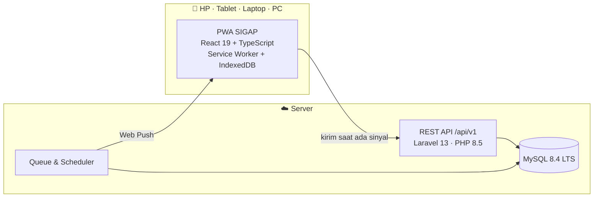

<div align="center">

# 🌿 SIGAP

**Sistem Integrasi Gudang, Aktivitas Sales, dan Pelanggan dengan Pelacakan Batch**

CRM & Inventory untuk **CV Arba'in Jaya Mandiri** — produsen dan distributor produk herbal di Surakarta


</div>

---

## 📌 Ringkasnya

> Sales mencatat kunjungan di HP **dalam hitungan detik, walau tanpa sinyal**. Satu catatan itu langsung memperbarui **stok, tagihan, riwayat outlet, dan laporan pimpinan**. Tidak ada lagi nota kertas yang disalin ke 4–5 file Excel.

| 😣 Masalah sekarang | ✅ Dengan SIGAP |
| --- | --- |
| Satu kunjungan diketik ulang di 4–5 file Excel | Dicatat sekali di HP, semua laporan ikut terbarui |
| Outlet terlewat berbulan-bulan | Daftar outlet diurutkan dari yang paling lama tidak dikunjungi |
| Produk kedaluwarsa di rak tidak terdeteksi | Batch & ED tercatat sampai ke tiap outlet, ada peringatan tarik |
| Tagihan tunda menumpuk tanpa daftar | Daftar belum dibayar per outlet, saran tagih otomatis |
| Pimpinan baru tahu kinerja di akhir bulan | Ringkasan harian: performa sales, outlet aktif, perputaran stok |

**Skala mitra:** 2 sales · ±260 outlet · ±60 produk · 7 kabupaten/kota · ±260 kunjungan per sales per bulan.

## 👥 Siapa memakai apa

Satu aplikasi PWA untuk semua peran. Bisa dipasang di HP, tablet, laptop, dan PC, dan menunya menyesuaikan izin tiap pengguna.

| Peran | Perangkat | Pekerjaan utama di SIGAP |
| --- | --- | --- |
| 🧑‍💼 **Sales** | HP, sering tanpa sinyal | Kunjungan titip jual (1 layar), beli langsung/tempo, nota WhatsApp, minta barang |
| 🗂️ **Admin Kantor** | Laptop/PC | Outlet & penugasan, produk & potongan, tagihan & setoran, laporan, pengaturan, impor Excel |
| 📦 **Admin Gudang** | PC/tablet | Barang masuk per batch, siapkan barang sales, retur, opname |
| 📊 **Pimpinan** | HP/laptop | Ringkasan, laporan, persetujuan potongan |

**Target kemudahan:** kunjungan tanpa perubahan ≤ **15 detik**, kunjungan biasa ≤ **2 menit**, tanpa mengetik huruf.

## 🏗️ Arsitektur



| Lapisan | Teknologi |
| --- | --- |
| Frontend | React 19 · TypeScript · Vite · Tailwind CSS 4 · shadcn/ui · TanStack Router/Query/Table |
| Offline | vite-plugin-pwa (Workbox) · Dexie (IndexedDB) |
| Backend | Laravel 13 · PHP 8.5 · Sanctum · spatie/laravel-permission · Laravel Excel |
| Basis data | MySQL 8.4 LTS (9.7 LTS bila hosting mendukung) |
| Kualitas | Pest · Larastan · Pint · oxlint · Vitest · Playwright |

Tiga prinsip desain sistem:
1. **Satu buku besar mutasi stok** untuk gudang, bawaan sales, dan outlet.
2. **Tidak ada aturan bisnis yang ditulis mati di kode.** Batas tagih, batas ED, persetujuan, dan izin diatur dari menu Pengaturan.
3. **Offline-first** untuk pekerjaan lapangan.

Rincian lengkap ada di [04 · System Design](docs/pengembangan/04_System_Design_Document.md).

## 📚 Dokumen pengembangan

Semua rancangan ada di [`docs/pengembangan/`](docs/pengembangan/). Baca sesuai kebutuhan:

| # | Dokumen | Baca bila ingin tahu… |
| --- | --- | --- |
| 01 | [Problem Discovery Report](docs/pengembangan/01_Problem_Discovery_Report.md) | Masalah mitra, temuan data Oktober 2026, siapa penggunanya |
| 02 | [Software Requirements Specification](docs/pengembangan/02_Software_Requirements_Specification.md) | Kebutuhan fungsional (MoSCoW), UX, non-fungsional, skenario uji |
| 03 | [Business Process Model](docs/pengembangan/03_Business_Process_Model.md) | Alur as-is → to-be P1–P10 (gudang, kunjungan, tagihan, retur, opname) |
| 04 | [System Design Document](docs/pengembangan/04_System_Design_Document.md) | Arsitektur, library, model data, logika bisnis, offline, API, izin |
| 05 | [Wireframe dan Mockup](docs/pengembangan/05_Wireframe_dan_Mockup.md) | Daftar layar M1–M6 (sales) dan W1–W13 (kantor), wireframe |
| 06 | [Rancangan Modul Maklon](docs/pengembangan/06_Rancangan_Modul_Maklon.md) | Modul maklon (fase setelah purwarupa inti) |
| 07 | [Pedoman UI/UX](docs/pengembangan/07_Pedoman_UI_UX.md) | **Wajib untuk frontend:** warna, huruf, komponen, bahasa, token CSS |
| 08 | [Struktur Folder](docs/pengembangan/08_Struktur_Folder.md) | **Wajib untuk semua developer:** susunan kode per modul |
| 09 | [Konvensi Kerja Tim](docs/pengembangan/09_Konvensi_Kerja_Tim.md) | **Wajib untuk semua developer:** branch, commit, Pull Request, definisi selesai |
| 10 | [Arsitektur Basis Data](docs/pengembangan/10_Arsitektur_Basis_Data.md) | **Wajib untuk backend:** prefix tabel per kelompok, aturan nama, katalog tabel, glosarium istilah → kode |

Bahan pendukung ada di [`docs/referensi/`](docs/referensi/) (profil mitra, proposal, review Figma). Keputusan teknis baru dicatat di [`docs/adr/`](docs/adr/).

## 🗂️ Struktur repo

```text
ums-hackaton-arb02/
├── .github/        Template Pull Request & issue
├── backend/        API Laravel 13 — modul per domain di app/Modules
├── frontend/       PWA React 19 — fitur per domain di src/features
└── docs/
    ├── pengembangan/   Dokumen rancangan 01–10 (sumber kebenaran)
    ├── referensi/      Bahan dari repo tim
    └── adr/            Catatan keputusan arsitektur
```

## 🚀 Memulai pengembangan

**Prasyarat:** Git, PHP 8.5, Composer 2, Node.js 26 LTS, dan MySQL 8.4 LTS atau lebih baru. Di Windows, WampServer, Laravel Herd, atau Laragon bisa menyediakan PHP dan MySQL.

```bash
# Backend → http://127.0.0.1:8000
cd backend
composer install
cp .env.example .env        # sesuaikan DB_* dengan MySQL lokal, buat database "sigap"
php artisan key:generate
php artisan migrate --seed   # tabel + peran/izin + akun contoh
php artisan serve

# Frontend → http://localhost:5173 (permintaan /api diteruskan ke backend)
cd frontend
npm install
npm run dev
```

**Akun contoh** (data fiktif, hanya dibuat di luar produksi). Kata sandi semuanya `sigap123`. Masuk bisa dengan username atau nomor HP.

| Username | Nomor HP | Peran | Setelah masuk |
| --- | --- | --- | --- |
| `pimpinan` | 081100000001 | Pimpinan | Area kantor |
| `kantor` | 081100000002 | Admin Kantor | Area kantor |
| `gudang` | 081100000003 | Admin Gudang | Area kantor |
| `sales1` | 081100000004 | Sales | Area lapangan (HP) |
| `sales2` | 081100000005 | Sales | Area lapangan (HP) |

Sebelum menulis kode, baca [07 · Pedoman UI/UX](docs/pengembangan/07_Pedoman_UI_UX.md), [08 · Struktur Folder](docs/pengembangan/08_Struktur_Folder.md), [09 · Konvensi Kerja Tim](docs/pengembangan/09_Konvensi_Kerja_Tim.md), dan [10 · Arsitektur Basis Data](docs/pengembangan/10_Arsitektur_Basis_Data.md). Singkatnya: **kode dan nama tabel berbahasa Inggris, tampilan berbahasa Indonesia**, dan tabel satu kelompok memakai prefix yang sama (`auth_`, `crm_`, `inv_`, `sls_`, …).

## 📅 Jadwal

| Tanggal | Kegiatan | Yang harus siap |
|---|---|---|
| 6 Nov 2026 | Pembekalan dan problem-owner clinic dengan mitra (Hotel Megaland) | Prototipe Figma, daftar pertanyaan, [deck paparan](https://claude.ai/artifact/SrTHvt3sYpFLrAQtUKqHfD) |
| 14 Nov 2026 | Hackathon Day 1: evaluasi progres dan penyaringan finalis | 5 fitur inti MVP bisa diperagakan |
| **15–27 Nov 2026** | **Pengembangan dan penyempurnaan aplikasi** | **Backlog P1–P2** |
| 28–29 Nov 2026 | Hackathon Day 2–3: camp, demo day, pemilihan juara | Skenario demo ±4 menit lancar |
| s.d. Apr 2027 | Uji kegunaan dan uji coba terbatas di mitra | Target TKT 6 |

## 🤝 Tim Antech Async

| Anggota | Peran | Memutuskan |
|---|---|---|
| Purwo Setiawan | Ketua · Analis kebutuhan, operasional dan regulasi | Kebutuhan klien dan fitur; komunikasi resmi dengan panitia |
| Ridwan Renaldi | **Lead developer** | Stack, arsitektur, kode yang masuk (review dan merge) |
| Muhammad Hammam Islami | Project manager · Bisnis dan hilirisasi | Jadwal, prioritas, pembagian tugas |
| Reza Amin Thohari | QA/Tester · UI halaman sales | Lulus atau tidaknya uji sebelum demo |

Semua anggota boleh ikut mengembangkan dan menawarkan bantuan di luar jobdesk. Keputusan tetap pada pemilik jobdesk di tabel di atas. **Yang membangun tidak menguji karyanya sendiri.**

## ⚠️ Aturan repo

- Repo sebaiknya **private**.
- **Jangan commit data mitra asli** (nama PIC, nomor HP, data penjualan). Pakai data contoh atau data yang sudah dianonimkan. Data dummy dari mitra disimpan di luar repo, kecuali mitra mengizinkan.
- Nomor BPOM di data contoh memakai awalan `TR-CONTOH-` dan bersifat fiktif.
- Riwayat penjualan untuk prediksi di data contoh adalah **data sintetis**. Jangan dipresentasikan sebagai data mitra.
- Kunci aplikasi, kata sandi basis data, dan konfigurasi server diisi lewat variabel lingkungan (`.env`), tidak di-commit.

## 🔗 Tautan

| Apa | Tautan |
| --- | --- |
| 🎨 Figma hi-fi (desain & prototipe, halaman "SIGAP · Hi-fi v2") | [Buka Figma](https://www.figma.com/design/cvBD4wgdf2jIGWW8NGOJZ7/SIGAP-%E2%80%94-Hi-fi-Prototype--ARB-02-?node-id=31-304) |
| 🧭 FigJam user flow | [Buka FigJam](https://www.figma.com/board/Dtii8Pg38TnDXi29melNsM/SIGAP-%E2%80%94-User-Flow--ARB-02-) |
| 📝 Notion: halaman utama tim (jadwal, notulensi, riset) | [Buka Notion](https://app.notion.com/p/4081d04a089181da802dd99c5c2f1504) |
| ✅ Notion: database Tugas Tim (PIC, status, tenggat) | [Buka Notion](https://app.notion.com/p/7eca86f1caf44a009f0d854c1915bce1) |
| ❓ Notion: daftar pertanyaan untuk mitra | [Buka Notion](https://app.notion.com/p/4081d04a08918180be65e151c4616037) |
| 🖥️ Deck paparan clinic 6 Nov (7 slide) | [Buka deck](https://claude.ai/artifact/SrTHvt3sYpFLrAQtUKqHfD) |
| 🏆 Laman tantangan ARB-02 | [ihub.ums.ac.id](https://ihub.ums.ac.id/hackathon/tantangan/arb-02-integrasi-data-pelanggan-aktivitas-sales-dan-stok) |

Halaman Notion dan deck paparan bersifat pribadi. Minta akses ke project manager (Hammam).
