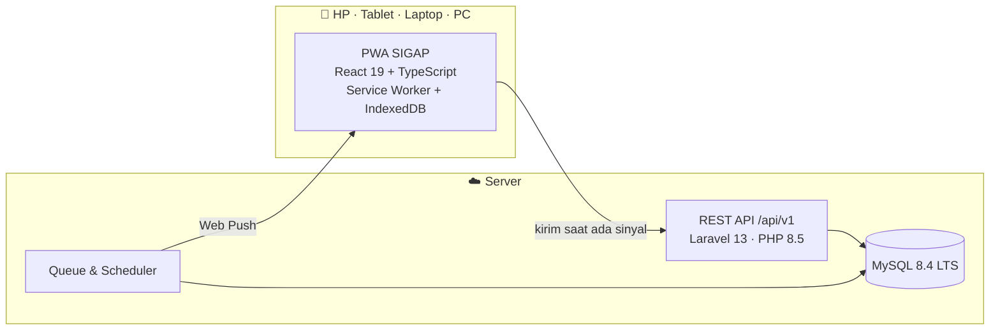

<div align="center">

# 🌿 SIGAP

**Sistem Integrasi Gudang, Aktivitas Sales, dan Pelanggan dengan Pelacakan Batch**

CRM & Inventory untuk **CV Arba'in Jaya Mandiri** — produsen dan distributor produk herbal di Surakarta


</div>

---

## 📌 Ringkasnya

> Sales mencatat kunjungan di HP **dalam hitungan detik, walau tanpa sinyal**. Satu catatan itu langsung memperbarui **stok, tagihan, riwayat outlet, dan laporan pimpinan**. Tidak ada lagi nota kertas yang disalin ke 4–5 file Excel.

| 😣 Masalah sekarang | ✅ Dengan SIGAP |
| --- | --- |
| Satu kunjungan diketik ulang di 4–5 file Excel | Dicatat sekali di HP, semua laporan ikut terbarui |
| Outlet terlewat berbulan-bulan | Daftar outlet diurutkan dari yang paling lama tidak dikunjungi |
| Produk kedaluwarsa di rak tidak terdeteksi | Batch & ED tercatat sampai ke tiap outlet, ada peringatan tarik |
| Tagihan tunda menumpuk tanpa daftar | Daftar belum dibayar per outlet, saran tagih otomatis |
| Pimpinan baru tahu kinerja di akhir bulan | Ringkasan harian: performa sales, outlet aktif, perputaran stok |

**Skala mitra:** 2 sales · ±260 outlet · ±60 produk · 7 kabupaten/kota · ±260 kunjungan per sales per bulan.

## 👥 Siapa memakai apa

Satu aplikasi PWA untuk semua peran. Bisa dipasang di HP, tablet, laptop, dan PC, dan menunya menyesuaikan izin tiap pengguna.

| Peran | Perangkat | Pekerjaan utama di SIGAP |
| --- | --- | --- |
| 🧑‍💼 **Sales** | HP, sering tanpa sinyal | Kunjungan titip jual (1 layar), beli langsung/tempo, nota WhatsApp, minta barang |
| 🗂️ **Admin Kantor** | Laptop/PC | Outlet & penugasan, produk & potongan, tagihan & setoran, laporan, pengaturan, impor Excel |
| 📦 **Admin Gudang** | PC/tablet | Barang masuk per batch, siapkan barang sales, retur, opname |
| 📊 **Pimpinan** | HP/laptop | Ringkasan, laporan, persetujuan potongan |

**Target kemudahan:** kunjungan tanpa perubahan ≤ **15 detik**, kunjungan biasa ≤ **2 menit**, tanpa mengetik huruf.

## 🏗️ Arsitektur



| Lapisan | Teknologi |
| --- | --- |
| Frontend | React 19 · TypeScript · Vite · Tailwind CSS 4 · shadcn/ui · TanStack Router/Query/Table |
| Offline | vite-plugin-pwa (Workbox) · Dexie (IndexedDB) |
| Backend | Laravel 13 · PHP 8.5 · Sanctum · spatie/laravel-permission · Laravel Excel |
| Basis data | MySQL 8.4 LTS (9.7 LTS bila hosting mendukung) |
| Kualitas | Pest · Larastan · Pint · oxlint · Vitest · Playwright |

Tiga prinsip desain sistem:
1. **Satu buku besar mutasi stok** untuk gudang, bawaan sales, dan outlet.
2. **Tidak ada aturan bisnis yang ditulis mati di kode.** Batas tagih, batas ED, persetujuan, dan izin diatur dari menu Pengaturan.
3. **Offline-first** untuk pekerjaan lapangan.

Rincian lengkap ada di [04 · System Design](docs/pengembangan/04_System_Design_Document.md).

## 📚 Dokumen pengembangan

Semua rancangan ada di [`docs/pengembangan/`](docs/pengembangan/). Baca sesuai kebutuhan:

| # | Dokumen | Baca bila ingin tahu… |
| --- | --- | --- |
| 01 | [Problem Discovery Report](docs/pengembangan/01_Problem_Discovery_Report.md) | Masalah mitra, temuan data Oktober 2026, siapa penggunanya |
| 02 | [Software Requirements Specification](docs/pengembangan/02_Software_Requirements_Specification.md) | Kebutuhan fungsional (MoSCoW), UX, non-fungsional, skenario uji |
| 03 | [Business Process Model](docs/pengembangan/03_Business_Process_Model.md) | Alur as-is → to-be P1–P10 (gudang, kunjungan, tagihan, retur, opname) |
| 04 | [System Design Document](docs/pengembangan/04_System_Design_Document.md) | Arsitektur, library, model data, logika bisnis, offline, API, izin |
| 05 | [Wireframe dan Mockup](docs/pengembangan/05_Wireframe_dan_Mockup.md) | Daftar layar M1–M6 (sales) dan W1–W13 (kantor), wireframe |
| 06 | [Rancangan Modul Maklon](docs/pengembangan/06_Rancangan_Modul_Maklon.md) | Modul maklon (fase setelah purwarupa inti) |
| 07 | [Pedoman UI/UX](docs/pengembangan/07_Pedoman_UI_UX.md) | **Wajib untuk frontend:** warna, huruf, komponen, bahasa, token CSS |
| 08 | [Struktur Folder](docs/pengembangan/08_Struktur_Folder.md) | **Wajib untuk semua developer:** susunan kode per modul |
| 09 | [Konvensi Kerja Tim](docs/pengembangan/09_Konvensi_Kerja_Tim.md) | **Wajib untuk semua developer:** branch, commit, Pull Request, definisi selesai |
| 10 | [Arsitektur Basis Data](docs/pengembangan/10_Arsitektur_Basis_Data.md) | **Wajib untuk backend:** prefix tabel per kelompok, aturan nama, katalog tabel, glosarium istilah → kode |
| 11 | [Pemantauan ED](docs/pengembangan/11_Pemantauan_ED.md) | Pelacakan batch/ED: daftar ambil gudang, cek ED di rak dan bawaan, koreksi batch, akurasi |

Bahan pendukung ada di [`docs/referensi/`](docs/referensi/) (profil mitra, proposal, review Figma). Keputusan teknis baru dicatat di [`docs/adr/`](docs/adr/).

**Panduan untuk mitra:** [Panduan Penggunaan](docs/panduan/Panduan_Penggunaan.md) per peran (sales, Admin Kantor, Admin Gudang, Pimpinan) dan [Panduan Migrasi Data](docs/panduan/Panduan_Migrasi_Data.md) dari Excel lama.

**Demo Day:** naskah ±4 menit, file impor, dan gladi otomatis ada di [`docs/demo/`](docs/demo/NASKAH_DEMO.md). Data demo dibuat dengan `php artisan migrate:fresh --seed --seeder=DemoSeeder`, lalu `npm run test:demo` menjalankan ketujuh langkah SRS §7 di aplikasi hasil build.

## 🗂️ Struktur repo

```text
ums-hackaton-arb02/
├── .github/        Template Pull Request & issue
├── backend/        API Laravel 13 — modul per domain di app/Modules
├── frontend/       PWA React 19 — fitur per domain di src/features
├── infra/docker/   Docker produksi (Caddy + HTTPS)
├── compose.yaml    Semua bagian di Docker untuk pengembangan lokal (Cara A)
└── docs/
    ├── pengembangan/   Dokumen rancangan 01–11 (sumber kebenaran)
    ├── referensi/      Bahan dari repo tim
    └── adr/            Catatan keputusan arsitektur
```

## 🚀 Menjalankan di lokal

SIGAP terdiri dari tiga bagian yang harus hidup bersamaan:

| Bagian | Alamat | Isi |
| --- | --- | --- |
| **Frontend** (PWA React) | http://localhost:5173 | Layar yang dibuka di browser. Permintaan `/api` diteruskan ke backend |
| **Backend** (API Laravel) | http://localhost:8000 | Data, aturan bisnis, login. Ditambah **antrean** (push, impor Excel) dan **scheduler** (tugas terjadwal) |
| **Basis data** (MySQL 8.4) | port 3306 (Docker: 3307) | Database `sigap` |

Pilih **satu** cara:

| Cara | Cocok untuk | Yang perlu dipasang |
| --- | --- | --- |
| [A. Docker](#cara-a--docker-windows-macos-linux) ⭐ | Semua orang. Paling mudah: satu perintah | Git + Docker |
| [B. Windows tanpa Docker](#cara-b--windows-tanpa-docker) | Laptop Windows yang sudah punya Laragon/Herd/WampServer | Git, PHP 8.5, Composer, MySQL, Node.js 26 |
| [C. Linux tanpa Docker](#cara-c--linux-tanpa-docker) | Laptop Linux yang ingin semuanya terpasang langsung | Git, PHP 8.5, Composer, MySQL, Node.js 26 |
| [D. Linux: backend di Docker, MySQL sendiri](#cara-d--linux-backend-di-docker-mysql-sendiri) | Linux yang sudah punya MySQL (di laptop atau container lain) | Git, Docker, Node.js 26 |

Pertama kali, ambil kodenya dulu:

```bash
git clone https://github.com/glayOne23/ums-hackaton-arb02.git
cd ums-hackaton-arb02
```

### Cara A — Docker (Windows, macOS, Linux)

Semua bagian (MySQL, backend, antrean, scheduler, frontend) berjalan di container lewat [`compose.yaml`](compose.yaml). Kode di folder `backend/` dan `frontend/` dibaca langsung oleh container, jadi perubahan kode langsung terlihat tanpa build ulang.

**Prasyarat**

- **Windows/macOS:** [Docker Desktop](https://www.docker.com/products/docker-desktop/). Di Windows, pilih backend **WSL 2** saat memasang, lalu pastikan Docker Desktop sudah berjalan (ikon paus di taskbar tidak bergerak lagi).
- **Linux:** Docker Engine + plugin Compose (`docker compose version` harus jalan).

**Langkah** (dari folder repo; di Windows pakai PowerShell atau Git Bash):

```bash
docker compose up -d
```

Start pertama butuh ±5–10 menit: Docker mengunduh image, memasang paket Composer dan npm, membuat `backend/.env`, membuat tabel, lalu mengisi akun dan data contoh. Pantau prosesnya:

```bash
docker compose logs -f backend    # tunggu sampai muncul "Development Server ... started"
docker compose ps                 # backend dan db harus "healthy"
```

Setelah itu buka **http://localhost:5173**, lalu masuk dengan salah satu [akun contoh](#akun-contoh). Start berikutnya hanya butuh beberapa detik.

**Perintah sehari-hari**

| Keperluan | Perintah |
| --- | --- |
| Menyalakan | `docker compose up -d` |
| Mematikan (data tetap tersimpan) | `docker compose down` |
| Melihat log | `docker compose logs -f backend` (atau `frontend`, `queue`, `db`) |
| Menjalankan perintah artisan | `docker compose exec backend php artisan <perintah>` |
| Mengulang database dari awal + data contoh | `docker compose exec backend php artisan migrate:fresh --seed` |
| Tes backend | `docker compose exec backend vendor/bin/pest` |
| Tes & lint frontend | `docker compose exec frontend npm run test` · `npm run lint` · `npm run typecheck` |
| Setelah `composer.json`/`package.json` berubah | `docker compose exec backend composer install` · `docker compose exec frontend npm install` |
| Hapus semuanya (database, paket) | `docker compose down -v` |

Membuka database dengan HeidiSQL/DBeaver/TablePlus: host `127.0.0.1`, port **3307**, user `sigap`, kata sandi `sigap`, database `sigap`.

> Catatan: paket Composer dan npm disimpan di volume Docker, bukan di folder repo. Editor yang butuh `vendor/` atau `node_modules/` untuk saran kode bisa memasangnya di laptop secara terpisah; keduanya sudah diabaikan git.

### Cara B — Windows tanpa Docker

**Prasyarat**

| Program | Versi | Cara memasang |
| --- | --- | --- |
| Git | terbaru | [git-scm.com](https://git-scm.com/download/win) |
| PHP | **8.5** | Lewat [Laragon](https://laragon.org), [Laravel Herd](https://herd.laravel.com/windows), atau WampServer. Bila PHP 8.5 belum ada di menunya, unduh zip **PHP 8.5 NTS x64** dari [windows.php.net](https://windows.php.net/download/), ekstrak ke folder PHP aplikasi tersebut, lalu pilih versinya |
| Composer | 2 | [getcomposer.org](https://getcomposer.org/download/) (installer Windows) |
| MySQL | 8.4 (8.0 juga bisa) | Bawaan Laragon/WampServer, atau [MySQL Installer](https://dev.mysql.com/downloads/installer/) |
| Node.js | **26** | [nodejs.org](https://nodejs.org) atau `winget install OpenJS.NodeJS` |

Periksa di PowerShell: `php -v` (harus 8.5), `composer -V`, `node -v` (harus v26), `mysql --version`.

Di `php.ini` (menu Laragon/Herd/Wamp → PHP → php.ini), aktifkan ekstensi berikut dengan menghapus tanda `;` di depannya: `curl`, `fileinfo`, `gd`, `intl`, `mbstring`, `openssl`, `pdo_mysql`, `zip`, `bcmath`, `exif`. Cek dengan `php -m`.

**1. Buat database** (lewat HeidiSQL/phpMyAdmin, atau perintah ini):

```powershell
mysql -u root -p -e "CREATE DATABASE sigap CHARACTER SET utf8mb4 COLLATE utf8mb4_unicode_ci"
```

**2. Backend** (PowerShell, dari folder repo):

```powershell
cd backend
composer install
Copy-Item .env.example .env       # lalu buka .env, isi DB_USERNAME dan DB_PASSWORD MySQL Anda
php artisan key:generate
php artisan webpush:vapid         # kunci notifikasi push (sekali saja)
php artisan migrate --seed        # tabel + peran/izin + akun & data contoh
php artisan serve                 # API di http://127.0.0.1:8000 (biarkan jendela ini terbuka)
```

Buka **dua jendela PowerShell lagi** di folder `backend` untuk antrean dan scheduler:

```powershell
php artisan queue:listen --tries=1 --timeout=0   # push ke perangkat, impor Excel
php artisan schedule:work                        # Tempat Sampah, notifikasi pagi
```

**3. Frontend** (jendela PowerShell baru, dari folder repo):

```powershell
cd frontend
npm install
npm run dev                       # buka http://localhost:5173
```

### Cara C — Linux tanpa Docker

Contoh untuk Ubuntu/Debian. Distribusi lain: sesuaikan nama paketnya.

**1. Pasang program**

```bash
# PHP 8.5 + ekstensi (Ubuntu belum menyediakan 8.5 di repo bawaan, jadi pakai PPA ondrej/php)
sudo add-apt-repository ppa:ondrej/php && sudo apt update
sudo apt install php8.5-cli php8.5-mysql php8.5-zip php8.5-intl php8.5-gd php8.5-bcmath \
  php8.5-mbstring php8.5-xml php8.5-curl unzip

# Composer 2
curl -sS https://getcomposer.org/installer | php && sudo mv composer.phar /usr/local/bin/composer

# Node.js 26 lewat nvm
curl -o- https://raw.githubusercontent.com/nvm-sh/nvm/v0.40.3/install.sh | bash
source ~/.bashrc && nvm install 26

# MySQL
sudo apt install mysql-server
```

**2. Buat database dan user.** MySQL bawaan Ubuntu tidak mengizinkan `root` masuk dengan kata sandi, jadi buat user khusus:

```bash
sudo mysql -e "CREATE DATABASE sigap CHARACTER SET utf8mb4 COLLATE utf8mb4_unicode_ci;
  CREATE USER 'sigap'@'localhost' IDENTIFIED BY 'sigap';
  GRANT ALL ON sigap.* TO 'sigap'@'localhost';"
```

**3. Backend** (dari folder repo):

```bash
cd backend
composer install
cp .env.example .env              # isi DB_USERNAME=sigap dan DB_PASSWORD=sigap
php artisan key:generate
php artisan webpush:vapid
php artisan migrate --seed
php artisan serve                 # http://127.0.0.1:8000
```

Di dua terminal lain (folder `backend`): `php artisan queue:listen --tries=1 --timeout=0` dan `php artisan schedule:work`.

**4. Frontend** (terminal baru):

```bash
cd frontend
npm install
npm run dev                       # http://localhost:5173
```

### Cara D — Linux: backend di Docker, MySQL sendiri

Untuk yang sudah punya MySQL (di laptop atau container lain dengan port terbuka) dan tidak ingin memasang PHP. Memakai [`backend/compose.yaml`](backend/compose.yaml) dengan `network_mode: host`, yang hanya berjalan penuh di Linux. Alasannya ada di [ADR 0003](docs/adr/0003-opsi-docker-backend-lokal.md).

```bash
cd backend
cp .env.example .env        # isi DB_HOST=127.0.0.1, DB_PORT (mis. 3307 bila MySQL di container), DB_*
docker compose build        # sekali, atau saat backend/docker/dev.Dockerfile berubah
docker compose run --rm app composer install
docker compose run --rm app php artisan key:generate
docker compose run --rm app php artisan webpush:vapid
docker compose run --rm app php artisan migrate --seed
docker compose up -d        # API di http://127.0.0.1:8000 + antrean + scheduler
docker compose logs -f app
```

Frontend dijalankan langsung: `cd frontend && npm install && npm run dev`.

### Akun contoh

Dibuat otomatis oleh `--seed` (data fiktif, hanya di luar produksi). Kata sandi semuanya **`sigap123`**. Masuk bisa dengan username atau nomor HP.

| Username | Nomor HP | Peran | Setelah masuk |
| --- | --- | --- | --- |
| `pimpinan` | 081100000001 | Pimpinan | Area kantor |
| `kantor` | 081100000002 | Admin Kantor | Area kantor |
| `gudang` | 081100000003 | Admin Gudang | Area kantor |
| `sales1` | 081100000004 | Sales | Area lapangan (HP) |
| `sales2` | 081100000005 | Sales | Area lapangan (HP) |

Layar sales paling enak dicoba dengan mode HP di browser: tekan `F12`, lalu `Ctrl+Shift+M`.

### Pemeriksaan sebelum membuka Pull Request

Sama dengan CI ([09 · Konvensi Kerja Tim](docs/pengembangan/09_Konvensi_Kerja_Tim.md) §5). Di Cara A, awali dengan `docker compose exec backend` atau `docker compose exec frontend`.

```bash
# backend/
vendor/bin/pint --test && vendor/bin/phpstan analyse && vendor/bin/pest

# frontend/
npm run lint && npm run typecheck && npm run test && npm run build
```

Tes end-to-end (`npm run test:e2e`) butuh backend berjalan dengan data contoh, dan sekali per laptop `npx playwright install chromium`.

### Masalah umum

| Gejala | Penyebab dan jalan keluar |
| --- | --- |
| `port is already allocated` / `address already in use` saat `docker compose up` | Port 3307, 8000, atau 5173 sudah dipakai program lain (mis. `php artisan serve` atau `npm run dev` yang masih hidup). Matikan programnya, lalu ulangi |
| Docker: `error during connect` / `cannot find the file specified` | Docker Desktop belum berjalan. Buka Docker Desktop, tunggu sampai siap, lalu ulangi |
| Layar masuk menampilkan "Server sedang bermasalah" | Backend belum siap atau mati. Lihat `docker compose logs backend` (Cara A) atau jendela `php artisan serve` |
| `SQLSTATE[HY000] [2002] Connection refused` | MySQL belum hidup, atau `DB_HOST`/`DB_PORT` di `backend/.env` salah |
| `Access denied for user 'root'@'localhost'` (1698) | MySQL bawaan Ubuntu menolak `root` dengan kata sandi. Pakai user khusus seperti di Cara C langkah 2 |
| `Your Composer dependencies require a PHP version ">= 8.5"` | PHP yang aktif masih versi lama. Pilih PHP 8.5 di Laragon/Herd/Wamp, lalu buka ulang terminal; cek `php -v` |
| `could not find driver` | Ekstensi `pdo_mysql` belum aktif di `php.ini` |
| `Permission denied` pada `storage/logs` atau `bootstrap/cache` (Linux) | Folder pernah dibuat oleh root. Jalankan `sudo chown -R $USER backend/storage backend/bootstrap/cache` |
| Frontend tidak memuat ulang setelah file diubah (Docker di Windows) | Sudah ditangani dengan polling (`VITE_USE_POLLING`). Bila masih, `docker compose restart frontend` |
| `npm ERR! engine` / Vite tidak mau jalan | Node.js masih versi lama. Pasang Node.js 26, cek `node -v` |

Sebelum menulis kode, baca [07 · Pedoman UI/UX](docs/pengembangan/07_Pedoman_UI_UX.md), [08 · Struktur Folder](docs/pengembangan/08_Struktur_Folder.md), [09 · Konvensi Kerja Tim](docs/pengembangan/09_Konvensi_Kerja_Tim.md), dan [10 · Arsitektur Basis Data](docs/pengembangan/10_Arsitektur_Basis_Data.md). Singkatnya: **kode dan nama tabel berbahasa Inggris, tampilan berbahasa Indonesia**, dan tabel satu kelompok memakai prefix yang sama (`auth_`, `crm_`, `inv_`, `sls_`, …).

## 🖥️ Menjalankan di server

**Cara cepat: Docker + HTTPS otomatis** (`infra/docker/`). Butuh server Linux dengan Docker, dan domain yang mengarah ke server itu (port 80 dan 443 terbuka). Caddy mengambil dan memperbarui sertifikat HTTPS sendiri, sehingga PWA bisa dipasang dan notifikasi push berjalan.

```bash
cp infra/docker/.env.example infra/docker/.env   # isi SIGAP_DOMAIN, APP_URL, kata sandi DB
docker compose -f infra/docker/compose.yaml build
docker compose -f infra/docker/compose.yaml run --rm app php artisan key:generate --show   # salin ke APP_KEY
docker compose -f infra/docker/compose.yaml run --rm app php artisan webpush:vapid --show   # salin ke VAPID_*
docker compose -f infra/docker/compose.yaml up -d
docker compose -f infra/docker/compose.yaml run --rm app php artisan migrate --force --seed
docker compose -f infra/docker/compose.yaml run --rm app php artisan sigap:admin-pertama <username> <nomor-hp>   # akun admin pertama
```

Isinya: `web` (Caddy: PWA + HTTPS), `app` (PHP-FPM), `queue`, `scheduler` (backup, Tempat Sampah, notifikasi pagi), dan `db` (MySQL 8.4). Foto, log, dan backup tersimpan di volume `storage`, jadi aman saat image diganti. Untuk versi baru: `git pull`, `build`, `up -d`, lalu `migrate --force`. `--seed` mengisi peran, izin, dan daftar pilihan awal (di produksi tanpa data contoh); `sigap:admin-pertama` mencetak kata sandi awal akun admin.

**Cara manual.** Di luar langkah Laravel biasa (`composer install --no-dev`, `.env` produksi, `php artisan migrate --force`, `npm run build` untuk frontend), server butuh tiga hal:

1. **Kunci push, sekali:** `php artisan webpush:vapid` (mengisi `VAPID_PUBLIC_KEY` dan `VAPID_PRIVATE_KEY` di `.env`). Jangan dibuat ulang setelah dipakai, karena langganan push di HP pengguna terikat ke kunci itu. Isi juga `VAPID_SUBJECT=mailto:email-admin` (atau URL https aplikasi); push ke iPhone menolak nilai lain.
2. **Pekerja antrean** yang selalu hidup, misalnya lewat Supervisor atau systemd: `php artisan queue:work --tries=3`.
3. **Cron scheduler** setiap menit: `* * * * * cd /path/ke/backend && php artisan schedule:run >> /dev/null 2>&1`. Scheduler juga menjalankan **backup harian** pukul 01.30 (database + foto/unggahan, `config/backup.php`), jadi server butuh `mysqldump` (paket `mysql-client`). Arahkan `BACKUP_DISK` ke disk di luar server (mis. S3) dan isi `BACKUP_NOTIFY_EMAIL` agar kegagalan backup terkirim ke email.

Notifikasi push hanya jalan lewat HTTPS (kecuali `localhost`), dan di iPhone hanya setelah SIGAP dipasang di layar utama (iOS 16.4+).

## 📅 Jadwal

| Tanggal | Kegiatan | Yang harus siap |
|---|---|---|
| 6 Nov 2026 | Pembekalan dan problem-owner clinic dengan mitra (Hotel Megaland) | Prototipe Figma, daftar pertanyaan, [deck paparan](https://claude.ai/artifact/SrTHvt3sYpFLrAQtUKqHfD) |
| 14 Nov 2026 | Hackathon Day 1: evaluasi progres dan penyaringan finalis | 5 fitur inti MVP bisa diperagakan |
| **15–27 Nov 2026** | **Pengembangan dan penyempurnaan aplikasi** | **Backlog P1–P2** |
| 28–29 Nov 2026 | Hackathon Day 2–3: camp, demo day, pemilihan juara | Skenario demo ±4 menit lancar |
| s.d. Apr 2027 | Uji kegunaan dan uji coba terbatas di mitra | Target TKT 6 |

## 🤝 Tim Antech Async

| Anggota | Peran | Memutuskan |
|---|---|---|
| Purwo Setiawan | Ketua · Analis kebutuhan, operasional dan regulasi | Kebutuhan klien dan fitur; komunikasi resmi dengan panitia |
| Ridwan Renaldi | **Lead developer** | Stack, arsitektur, kode yang masuk (review dan merge) |
| Muhammad Hammam Islami | Project manager · Bisnis dan hilirisasi | Jadwal, prioritas, pembagian tugas |
| Reza Amin Thohari | QA/Tester · UI halaman sales | Lulus atau tidaknya uji sebelum demo |

Semua anggota boleh ikut mengembangkan dan menawarkan bantuan di luar jobdesk. Keputusan tetap pada pemilik jobdesk di tabel di atas. **Yang membangun tidak menguji karyanya sendiri.**

## ⚠️ Aturan repo

- Repo sebaiknya **private**.
- **Jangan commit data mitra asli** (nama PIC, nomor HP, data penjualan). Pakai data contoh atau data yang sudah dianonimkan. Data dummy dari mitra disimpan di luar repo, kecuali mitra mengizinkan.
- Nomor BPOM di data contoh memakai awalan `TR-CONTOH-` dan bersifat fiktif.
- Riwayat penjualan untuk prediksi di data contoh adalah **data sintetis**. Jangan dipresentasikan sebagai data mitra.
- Kunci aplikasi, kata sandi basis data, dan konfigurasi server diisi lewat variabel lingkungan (`.env`), tidak di-commit.

## 🔗 Tautan

| Apa | Tautan |
| --- | --- |
| 🎨 Figma hi-fi (desain & prototipe, halaman "SIGAP · Hi-fi v2") | [Buka Figma](https://www.figma.com/design/cvBD4wgdf2jIGWW8NGOJZ7/SIGAP-%E2%80%94-Hi-fi-Prototype--ARB-02-?node-id=31-304) |
| 🧭 FigJam user flow | [Buka FigJam](https://www.figma.com/board/Dtii8Pg38TnDXi29melNsM/SIGAP-%E2%80%94-User-Flow--ARB-02-) |
| 📝 Notion: halaman utama tim (jadwal, notulensi, riset) | [Buka Notion](https://app.notion.com/p/4081d04a089181da802dd99c5c2f1504) |
| ✅ Notion: database Tugas Tim (PIC, status, tenggat) | [Buka Notion](https://app.notion.com/p/7eca86f1caf44a009f0d854c1915bce1) |
| ❓ Notion: daftar pertanyaan untuk mitra | [Buka Notion](https://app.notion.com/p/4081d04a08918180be65e151c4616037) |
| 🖥️ Deck paparan clinic 6 Nov (7 slide) | [Buka deck](https://claude.ai/artifact/SrTHvt3sYpFLrAQtUKqHfD) |
| 🏆 Laman tantangan ARB-02 | [ihub.ums.ac.id](https://ihub.ums.ac.id/hackathon/tantangan/arb-02-integrasi-data-pelanggan-aktivitas-sales-dan-stok) |

Halaman Notion dan deck paparan bersifat pribadi. Minta akses ke project manager (Hammam).
