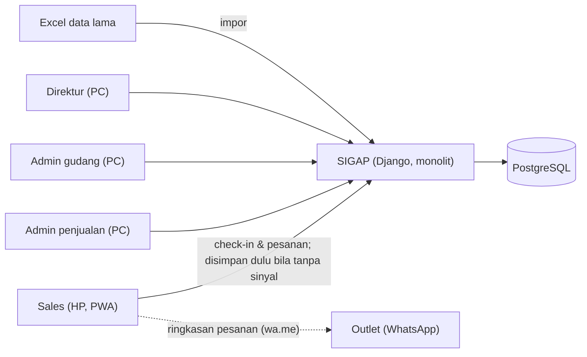

# 06 · Arsitektur dan stack

Stack mengikuti proposal v03 (Lampiran C.1). Keputusan akhir ada di lead developer (Ridwan).

| Bagian | Pilihan | Catatan |
|---|---|---|
| Aplikasi dan panel | **Django** (monolit) | Django admin atau templat Django untuk panel admin penjualan dan admin gudang; templat Django untuk dashboard direktur |
| Halaman sales | **Satu halaman** templat Django + JavaScript + **Dexie.js** (IndexedDB) | Pindah layar di JavaScript; data lewat endpoint JSON. Alpine.js opsional |
| PWA | Manifest + service worker yang menyimpan cangkang aplikasi | Tanpa Background Sync; kirim lewat event `online`, cek 15 detik, tombol "Kirim sekarang" |
| Basis data | **PostgreSQL** 16, satu server | `transaction.atomic` + `select_for_update()` untuk stok |
| Impor Excel | Mis. `django-import-export` **[pilih]** | Cek duplikat nomor HP |
| Prediksi | Exponential smoothing (Holt), Python tanpa pustaka tambahan | WAPE dibanding ramalan naif |
| Uji | Uji unit untuk aturan stok + uji E2E di Chrome tampilan HP | Termasuk emulasi mode tanpa sinyal dan dua HP |
| Hosting demo | VPS dengan **HTTPS** | GPS dan service worker di browser HP butuh HTTPS |

Prinsip: satu aplikasi, satu basis data, tanpa layanan pihak ketiga atau API berbayar. Komponen sumber terbuka, bisa di-hosting di Indonesia.

## Endpoint JSON minimum (usulan)

| Endpoint | Fungsi |
|---|---|
| `GET /api/katalog` | Produk, stok tersedia, outlet milik sales, dan waktu server (untuk label "per jam sinkron") |
| `GET /api/kunjungan-hari-ini` | Outlet berurutan dengan alasan |
| `POST /api/kunjungan` | Check-in (lokasi, jam) atau lewati dengan alasan |
| `POST /api/pesanan` | Pesanan dari HP, idempoten lewat `client_uuid`; jawaban per baris (diterima, sebagian, ditolak + sisa stok) |
| `GET /api/pesanan-saya` | Status pesanan sales |
| `POST /api/pesanan/<id>/batal` | Batalkan sebelum kirim (alasan wajib) |
| `POST /api/pesanan/<id>/kirim` | Konfirmasi kirim dengan FEFO |
| `POST /api/penyesuaian` | Opname / penyesuaian (alasan wajib) |
| `GET /api/telusur-batch/<no_batch>` | Outlet penerima suatu batch |
| `GET /api/prediksi` | Prediksi 4 minggu dan saran produksi |

Endpoint untuk mengisi ulang data contoh hanya boleh ada di lingkungan pengembangan.
