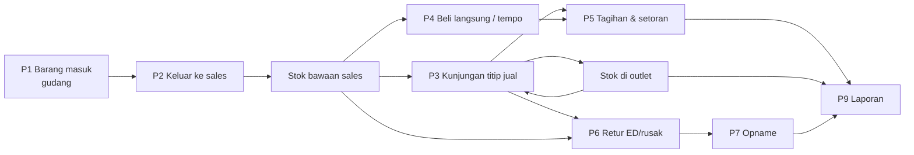
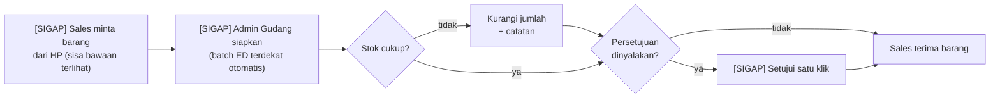
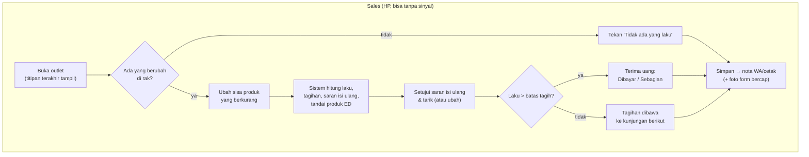
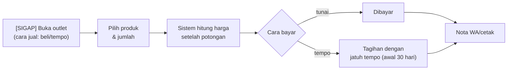
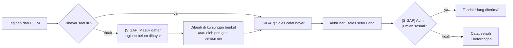
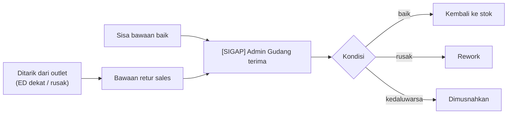
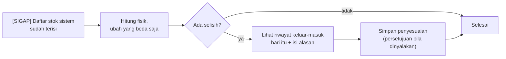
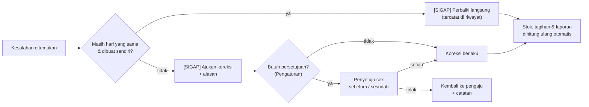

# Business_Process_Model — SIGAP CV Arba'in

16 November 2026 · Ren (Antech Async) · Versi online: https://claude.ai/artifact/YGEyzE3nvQ3MLHSZ2ksfSa

**Versi 2 — analisis ulang.** Alur diringkas: sales cukup mengubah yang berbeda, persetujuan hanya di barang keluar gudang dan perubahan potongan (keduanya bisa dimatikan), dan modul maklon dirancang terpisah di dokumen 06.

Dokumen ini memetakan proses CV Arba'in **saat ini (as-is)** dan **dengan SIGAP (to-be)**. Langkah bertanda **\[SIGAP\]** dicatat di aplikasi. Angka seperti "> 2 item" dan "6 bulan" adalah nilai awal di menu Pengaturan, bukan aturan yang dikunci di program.

## 0. Peta proses

| Kode | Proses | Pelaku | Keluaran |
| --- | --- | --- | --- |
| P1 | Barang masuk gudang | Admin Gudang | Stok + batch + ED |
| P2 | Barang keluar ke sales | Sales, Admin Gudang | Stok bawaan sales |
| P3 | Kunjungan outlet titip jual | Sales | Laku, tagihan, isi ulang, nota |
| P4 | Penjualan beli langsung / tempo | Sales, Admin Kantor | Nota & tagihan dengan jatuh tempo |
| P5 | Tagihan, pembayaran & setoran | Sales, Admin Kantor | Tagihan lunas, uang diterima |
| P6 | Retur, rusak & kedaluwarsa | Sales, Admin Gudang | Stok kembali / rework / musnah |
| P7 | Opname gudang | Admin Gudang | Selisih tertelusur |
| P8 | Data outlet, produk, potongan & pengaturan | Admin Kantor, Pimpinan | Data & aturan aktif |
| P9 | Laporan | Pimpinan, Admin Kantor | Ringkasan & 12 laporan |

## 1. Gambaran besar (to-be)

Semua perpindahan barang (gudang → sales → outlet → kembali) tercatat otomatis dari kegiatan sehari-hari, jadi tidak ada lagi rekap yang diketik ulang.

## 2. P1 — Barang masuk gudang

|  | As-is | To-be |
| --- | --- | --- |
| Langkah | Produksi menyerahkan barang; admin mencatat jumlah, batch, ED di Excel | **\[SIGAP\]** Admin memilih produk, mengetik batch & ED, mengisi jumlah, lalu simpan |
| Hasil | Kartu stok di Excel | Stok gudang & kartu stok terbarui otomatis |

## 3. P2 — Barang keluar ke sales

Sisa bawaan dari perjalanan sebelumnya otomatis ikut terhitung, jadi sales hanya meminta kekurangannya.

## 4. P3 — Kunjungan outlet titip jual

**As-is:** sales membersihkan rak, menghitung sisa, membandingkan dengan nota lama, menghitung laku dan tagihan manual, mengisi ulang, menulis nota baru, lalu meminta cap & tanda tangan. Di kantor semuanya disalin ke Excel.

**To-be:**

Yang dihapus dari pekerjaan sales: membawa nota lama, menghitung laku, menghitung harga setelah potongan, dan menyalin ke Excel. Yang tetap: form fisik bercap sebagai bukti sah.

## 5. P4 — Penjualan beli langsung / tempo

Cocok untuk distributor (tempo 1 bulan) dan outlet yang membeli putus. Cara jual dipilih per outlet, sehingga satu aplikasi melayani kedua model.

## 6. P5 — Tagihan, pembayaran & setoran

Tidak ada jurnal atau rekonsiliasi akuntansi; pembukuan tetap memakai cara keuangan yang ada, dengan data dari ekspor SIGAP.

## 7. P6 — Retur, rusak & kedaluwarsa

## 8. P7 — Opname gudang

## 9. P8 — Data & pengaturan

| Kegiatan | Pelaku | Catatan |
| --- | --- | --- |
| Tambah/ubah outlet, gabungkan outlet dobel | Admin Kantor | Sales boleh mengusulkan outlet baru dari lapangan |
| Tugaskan outlet ke 1+ sales | Admin Kantor | Alasan pindah dicatat; sales baru diberi notifikasi |
| Ubah harga & potongan | Admin Kantor (Manager Marketing) | Berlaku setelah disetujui Pimpinan, bila persetujuan dinyalakan |
| Ubah aturan (batas tagih, ED, siklus, tempo, foto wajib) | Admin Kantor | Berlaku untuk transaksi berikutnya, tercatat di riwayat |
| Atur peran & hak akses | Admin Kantor | Centang per menu/aksi |

## 10. P9 — Pelaporan

|  | As-is | To-be |
| --- | --- | --- |
| Cara | Nota → diketik ke 4–5 Excel | Tercatat sekali, laporan terbentuk otomatis |
| Waktu | Akhir bulan | Kapan saja |
| Penanda | Warna sel kuning | Tanda & filter (belum dikunjungi, setor terbanyak, ED dekat) |
| Keluaran | Excel/PDF manual | Ringkasan + ekspor Excel/PDF dengan susunan kolom yang sama |

## 10b. P10 — Koreksi kesalahan (berlaku untuk semua proses)

| Contoh kejadian | Siapa | Tindakan di SIGAP |
| --- | --- | --- |
| Sales salah ketik sisa (harusnya 1, tertulis 11) | Sales, hari itu juga | Buka nota → "Perbaiki" → simpan; nota baru terkirim ulang ke WA outlet |
| Kunjungan dicatat ke outlet yang salah | Admin Kantor | "Ajukan koreksi" → pindahkan ke outlet yang benar; stok kedua outlet terhitung ulang |
| Permintaan barang terlanjur disetujui padahal jumlah salah | Admin Gudang | "Ubah status" ke Disiapkan + alasan → ubah jumlah → setujui ulang |
| Pembayaran dicatat dua kali | Admin Kantor | Batalkan salah satu pembayaran + alasan; sisa tagihan kembali otomatis |
| Barang masuk salah batch/ED | Admin Gudang | Koreksi barang masuk; batch di gudang, bawaan sales, dan outlet ikut diperbarui |
| Outlet terhapus tidak sengaja | Admin Kantor | Pulihkan dari Tempat Sampah |
| Order maklon maju status terlalu cepat | Marketing | "Ubah status" mundur satu tahap + alasan |

## 11. Modul maklon (dokumen terpisah)

Alur maklon dari QnA (spesifikasi → sampel Rp500.000 → perizinan Rp7.500.000 dengan DP 50% → PO & DP 50% → produksi 2–3 pekan → QC → pelunasan → kirim) dirancang lengkap di dokumen 06\_Rancangan\_Modul\_Maklon (alur, status, tagihan bertahap, bahan milik klien, layar) dan dibangun setelah purwarupa inti, sesuai batasan brief.

## 12. Ringkasan perubahan as-is → to-be

| Titik | As-is | To-be |
| --- | --- | --- |
| Titipan per outlet | Nota kertas di tangan sales | Tampil otomatis saat outlet dibuka |
| Hitung laku & tagihan | Manual | Otomatis |
| Kunjungan tanpa perubahan | Tetap menulis nota | Satu tombol |
| Isi ulang | Kira-kira | Saran dari stok standar |
| ED di outlet | Tidak terpantau | Ditandai di layar sales |
| Aturan bisnis berubah | Diberitahu lisan | Diubah sekali di Pengaturan |
| Rekap bulanan | 4–5 file | Sekali klik ekspor |
