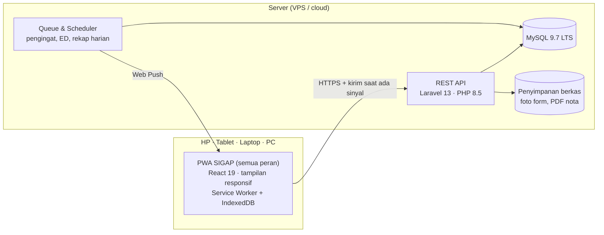
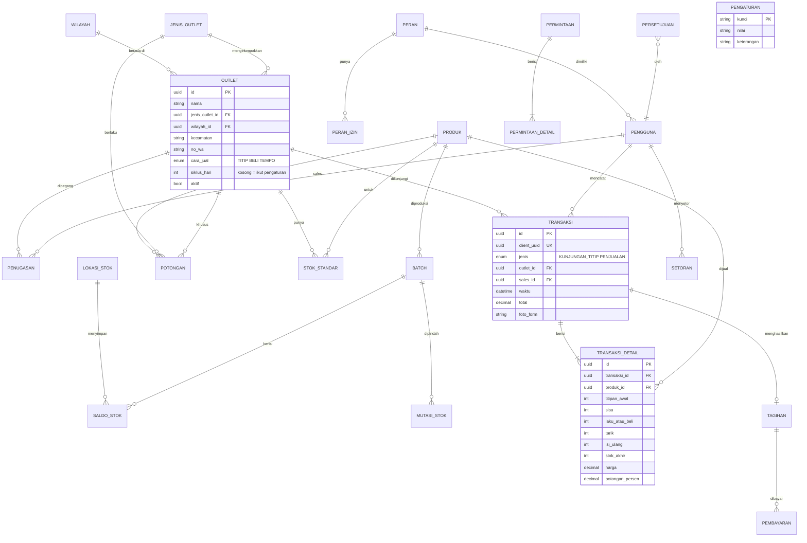
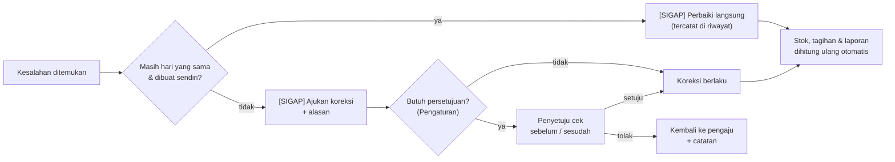
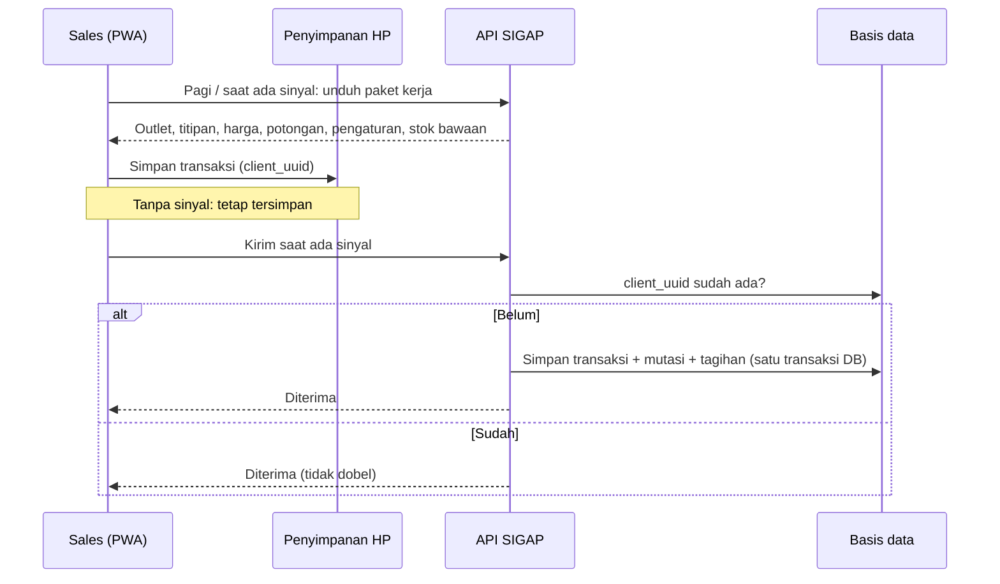

# System_Design_Document — SIGAP CV Arba'in

16 November 2026 · Ren (Antech Async) · Versi online: https://claude.ai/artifact/VpBs458nCupU99id9j2ZAP

**Versi 2 — analisis ulang.** Fleksibilitas dibangun ke dalam data: aturan bisnis disimpan di tabel Pengaturan, hak akses di tabel peran-izin, persetujuan memakai satu mekanisme umum, dan kunjungan titip jual maupun penjualan langsung memakai satu tabel transaksi.

Rancangan teknis SIGAP untuk memenuhi Software\_Requirements\_Specification v2. Ada tiga prinsip: (1) **satu buku besar mutasi stok** untuk gudang, bawaan sales, dan outlet; (2) **tidak ada aturan bisnis yang ditulis mati di kode**, semuanya dibaca dari Pengaturan; (3) **aplikasi sales offline-first** dan seringan mungkin. Teknologi di bawah adalah rekomendasi dan bisa disesuaikan dengan keahlian tim.

## 1. Arsitektur

| Lapisan | Pilihan (versi stabil terbaru, per November 2026) | Alasan |
| --- | --- | --- |
| Bahasa backend | PHP 8.5 (rilis 20 Nov 2025; security sampai 31 Des 2029) | Versi PHP terbaru yang didukung Laravel 13 |
| Framework backend | Laravel 13 (rilis 17 Mar 2026; bug fix sampai Q3 2027, security sampai 17 Mar 2028) | Auth, queue, scheduler, validasi, ORM, impor Excel sudah siap pakai |
| Autentikasi API | Laravel Sanctum (versi yang menyertai Laravel 13) | Token untuk PWA + sesi untuk web admin |
| Frontend | React 19.3 + TypeScript, Vite 8.3, Tailwind CSS 4.3 | Satu aplikasi PWA untuk semua peran; tampilan menyesuaikan HP, tablet, laptop, PC; menu menyesuaikan izin |
| Offline | Service Worker (vite-plugin-pwa / Workbox) + IndexedDB (Dexie) | Kunjungan, penjualan, dan transaksi gudang tersimpan di perangkat tanpa sinyal |
| Build tool | Node.js 26 LTS (active support sampai 27 Okt 2027) | Hanya dipakai saat build frontend |
| Basis data | MySQL 9.7 LTS (rilis 21 Apr 2026; premier support sampai 30 Apr 2031). Alternatif: MySQL 8.4 LTS bila hosting belum menyediakan 9.7 | Transaksi ACID untuk stok; LTS agar stabil |
| Queue & scheduler | Queue driver database + Laravel Scheduler | Tidak perlu Redis di purwarupa; cukup satu server |
| Impor/ekspor | Laravel Excel 4 (impor dengan pratinjau), spatie/laravel-pdf v2 dengan driver DomPDF untuk nota | Admin terbiasa Excel |
| Notifikasi | Web Push; tautan WhatsApp (wa.me) untuk berbagi nota | Tanpa biaya SMS/API WA |

Catatan pembaruan versi: Laravel 14 diperkirakan rilis Q1 2027 dan butuh PHP 8.4+. Karena server sudah memakai PHP 8.5 dan Laravel 13 minim perubahan yang merusak, upgrade nanti diperkirakan ringan. Saat implementasi, setiap paket dikunci di versi stabil terbaru (`composer.json`, `package.json`).

### 1.1 Kenapa Laravel, bukan Django?

Keduanya sama-sama mampu membangun SIGAP. Pilihan jatuh ke Laravel karena faktor tim dan operasional, bukan karena Django kurang mampu.

| Aspek | Laravel 13 (PHP) | Django 6.1 (Python) |
| --- | --- | --- |
| Keahlian tim | Bila tim sudah terbiasa Laravel, tidak perlu belajar dari awal di masa hackathon | Perlu belajar Python/Django bila tim belum terbiasa |
| REST API untuk PWA | Bawaan: routing API, API Resource, Sanctum | Perlu Django REST Framework (paket pihak ketiga) atau Django Ninja |
| Antrian & penjadwal | Bawaan: Queue + Scheduler, cukup driver database | Butuh Celery + Redis/RabbitMQ atau django-q; tambahan komponen |
| Panel admin | Tidak ada bawaan; dibuat sendiri (atau Filament) | **Unggul**: Django Admin siap pakai untuk CRUD back-office |
| Peran & izin | Gate/Policy bawaan; tabel izin dibuat sendiri atau paket spatie/laravel-permission | **Unggul**: model User, Group, Permission bawaan |
| Impor/ekspor Excel | Laravel Excel matang, mendukung pratinjau & antrian | openpyxl / django-import-export; juga matang |
| Analitik data | Cukup untuk agregat SQL | **Unggul** bila nanti butuh analisis lanjut (pandas, prediksi stok) |
| Hosting di Indonesia | Hosting PHP murah dan umum (shared hosting/cPanel) | Butuh VPS/PaaS dengan WSGI/ASGI; sedikit lebih teknis |
| Komunitas & tenaga kerja lokal | Sangat besar di Indonesia | Besar, tetapi developer web Python lebih sedikit |
| Siklus rilis & dukungan | Rilis mayor tiap tahun; security 2 tahun | Feature release tiap \~8 bulan; LTS 3 tahun (5.2 LTS sampai Apr 2028; LTS berikutnya 6.2) |

Kesimpulan: untuk purwarupa hackathon yang harus cepat jadi dan mudah di-hosting mitra, Laravel lebih praktis. Django layak dipilih bila tim lebih kuat di Python atau mitra nanti membutuhkan analitik/prediksi stok yang berat. Rancangan data dan API di dokumen ini tidak terikat framework, jadi bisa dipakai untuk keduanya.

### 1.2 Satu PWA untuk semua peran dan perangkat

SIGAP dibangun sebagai **satu aplikasi web progresif (PWA)**. Pimpinan, admin kantor, admin gudang, dan sales membuka aplikasi yang sama, bisa memasangnya di layar utama HP/tablet atau sebagai aplikasi di laptop/PC, lalu melihat menu sesuai izinnya. Tidak ada aplikasi terpisah untuk admin dan sales, sehingga hanya ada satu kode, satu cara login, dan satu alamat.

| Ukuran layar | Perangkat | Pola tampilan |
| --- | --- | --- |
| < 640 px | HP | Navigasi bawah (maks. 4 menu utama + "Lainnya"), tabel menjadi kartu, filter di lembar bawah, tombol utama di bawah |
| 640–1024 px | Tablet, HP landscape | Menu samping yang bisa diciutkan, tabel ringkas (kolom penting saja), form dua kolom |
| > 1024 px | Laptop, PC | Menu samping tetap, tabel penuh dengan cari/filter/urutkan, panel detail di samping |

| Peran | Tanpa sinyal | Data yang disimpan di perangkat |
| --- | --- | --- |
| Sales | Baca & tulis penuh (kunjungan, penjualan, pembayaran, minta barang) | Paket kerja: outlet tugas, titipan, harga, potongan, pengaturan, stok bawaan |
| Admin Gudang | Tulis: barang masuk, terima retur, opname; dikirim saat ada sinyal | Daftar produk, batch, saldo gudang |
| Admin Kantor | Hanya baca data terakhir; perubahan data butuh sinyal | Ringkasan & daftar yang terakhir dibuka |
| Pimpinan | Hanya baca ringkasan terakhir | Ringkasan pimpinan |

Catatan teknis:

- Mekanisme offline (IndexedDB + `client_uuid` + kirim ulang otomatis) di bagian 5 dipakai bersama oleh sales dan gudang.
- Data di perangkat dibatasi per peran dan dihapus saat pengguna keluar, supaya HP/PC bersama tetap aman.
- Kode tiap peran dimuat terpisah (code splitting), sehingga HP sales tidak mengunduh halaman admin.
- Versi baru dipasang otomatis di latar; pengguna melihat tombol "Muat ulang" tanpa perlu instal ulang.
- Notifikasi push berjalan di Android, Windows, macOS, dan iPhone/iPad iOS 16.4+ bila aplikasi sudah dipasang di layar utama.

### 1.3 Library yang dipakai

Prinsip memilih library: (1) utamakan paket resmi Laravel atau pengelola besar yang aktif (Spatie, TanStack) dan sudah mendukung Laravel 13 / React 19 / Vite 8; (2) hindari kit UI berat (MUI, Ant Design) supaya aplikasi tetap ringan di HP sales; (3) setiap library punya satu tugas jelas, tidak tumpang-tindih. Versi dikunci di `composer.json` dan `package.json` saat proyek dibuat.

**Backend (Laravel 13)**

| Kebutuhan | Library | Alasan | Tidak dipilih |
| --- | --- | --- | --- |
| Autentikasi API & sesi | Laravel Sanctum | Paket resmi; token untuk PWA, ringan | Passport (OAuth berlebihan untuk kebutuhan ini) |
| Peran & izin (PG-08) | spatie/laravel-permission v7 (Laravel 12–13, PHP 8.3+) | Standar de facto; peran & izin disimpan di tabel, cocok untuk "centang izin" | Gate/Policy murni (izin jadi tertulis di kode, tidak fleksibel) |
| Riwayat perubahan (AK-03) | spatie/laravel-activitylog | Mencatat siapa, kapan, nilai lama/baru per model secara otomatis | Tabel audit buatan sendiri |
| Impor/ekspor Excel (IE) | maatwebsite/excel 4 (Laravel 12–13) | Paling matang; impor besar via antrian, validasi per baris untuk pratinjau | OpenSpout langsung (lebih cepat tapi fitur validasi harus dibuat sendiri) |
| PDF nota & laporan | spatie/laravel-pdf v2, driver DomPDF | Jalan tanpa Chrome/Node, cocok untuk hosting biasa; nanti bisa pindah ke driver Browsershot/Gotenberg tanpa ubah kode | barryvdh/laravel-dompdf (tanpa opsi ganti driver) |
| Filter, urut, cari tabel lewat URL | spatie/laravel-query-builder | Tabel ala Excel (UX-10) dengan sedikit kode | Query manual per endpoint |
| Dokumentasi API (OpenAPI) | dedoc/scramble | OpenAPI dibuat otomatis dari kode; jadi sumber tipe untuk frontend | Scribe / anotasi manual (mudah usang) |
| Notifikasi push (PW-08) | laravel-notification-channels/webpush | Web Push lewat sistem Notification Laravel | Firebase Cloud Messaging (tambahan akun & SDK) |
| Backup harian (NF-06) | spatie/laravel-backup | Backup DB + berkas terjadwal, bisa ke penyimpanan luar | Skrip cron manual |
| Pemantauan | Laravel Pulse | Paket resmi; lihat request lambat & antrian dari satu halaman | Layanan APM berbayar |

**Frontend (PWA React 19)**

| Kebutuhan | Library | Alasan | Tidak dipilih |
| --- | --- | --- | --- |
| PWA, service worker, update otomatis (PW-02, PW-09) | vite-plugin-pwa (Workbox), mode `injectManifest` + prompt "Muat ulang" | Standar untuk Vite; sudah mendukung Vite 8 | Workbox manual |
| Routing | TanStack Router v1 | Paling aman tipe untuk SPA; code splitting per peran mudah | React Router v7 (unggul untuk SSR, tidak dibutuhkan di sini) |
| Data dari server + cache baca offline (PW-07) | TanStack Query v5 + persist client ke IndexedDB | Cache, retry, refetch saat online kembali; data terakhir tetap tampil tanpa sinyal | SWR, Redux Toolkit Query |
| Antrean transaksi offline (PW-05, PW-06) | Dexie 4 + dexie-react-hooks | IndexedDB yang mudah, query reaktif, andal di Android & iOS | localStorage (terlalu kecil), RxDB (berat) |
| Komponen UI | shadcn/ui (Tailwind CSS 4) | Komponen disalin ke repo, aksesibel, bisa diubah bebas; ada Drawer untuk lembar bawah di HP | MUI / Ant Design (berat, tampilan sulit disesuaikan) |
| Tabel (UX-10, PW-04) | TanStack Table v8 | Sort/filter/pagination tanpa tampilan bawaan, jadi bisa dirender sebagai tabel di PC dan kartu di HP | AG Grid (berat, fitur premium berbayar) |
| Form & validasi | React Hook Form + Zod 4 | Ringan, sedikit render ulang; skema Zod dipakai bersama untuk validasi form & data offline | Formik (kurang aktif) |
| Tipe & hook API otomatis | Orval (dari OpenAPI Scramble) | Hook TanStack Query + tipe TypeScript dibuat otomatis, tidak ada salah ketik endpoint | Menulis fetch manual |
| Grafik ringkasan | Recharts (via komponen chart shadcn/ui) | Cukup untuk bar/line/donut, gaya seragam dengan UI | Chart.js, ECharts (lebih berat) |
| State ringan (sesi, preferensi) | Zustand | Sangat kecil, tanpa boilerplate | Redux |
| Tanggal & angka | date-fns (locale `id`) + `Intl.NumberFormat` untuk Rupiah | Modular, hanya fungsi yang dipakai yang terbawa | Moment.js (usang & berat) |
| Ikon & notifikasi kecil | lucide-react, sonner | Ringan, gaya serasi dengan shadcn/ui | — |
| Kompres foto form (NF-02) | browser-image-compression | Foto ≤ 200 KB sebelum dikirim | Kompres di server (boros kuota sales) |
| Pindai barcode (PW-10, opsional) | @zxing/browser | Jalan di Android & iOS lewat kamera | Aplikasi native |

**Kualitas & pengujian**

| Kebutuhan | Library |
| --- | --- |
| Tes backend | Pest 4 (+ pest-plugin-laravel) |
| Analisis statis PHP | Larastan |
| Format kode PHP | Laravel Pint |
| Tes unit frontend | Vitest + Testing Library |
| Tes end-to-end (termasuk mode offline & ukuran HP/tablet/PC) | Playwright |
| Lint & format JS/TS | ESLint (typescript-eslint) + Prettier |
| CI | GitLab CI: jalankan Pint, Larastan, Pest, ESLint, Vitest, Playwright setiap merge request |

## 2. Modul

| Modul | Kebutuhan SRS | Layar utama |
| --- | --- | --- |
| Outlet (CRM) | OT-01–07 | Daftar outlet, profil outlet, penugasan, gabung outlet |
| Produk & harga | PR-01–04 | Produk, potongan, daftar harga |
| Gudang | GD-01–08 | Barang masuk, permintaan sales, retur, opname, kartu stok |
| Kunjungan sales | KS-01–14 | Outlet saya, kunjungan, nota, stok bawaan, hari ini |
| Tagihan | TG-01–04 | Belum dibayar, pembayaran, setoran |
| Laporan | LP-01–12 | Ringkasan, performa sales, outlet aktif, perputaran stok, 8 laporan CATATAN |
| Pengaturan | PG-01–10, AK, IE | Aturan, peran & izin, pengguna, impor/ekspor |

## 3. Model data

### 3.1 Tabel yang membuat sistem fleksibel

| Tabel | Isi | Contoh |
| --- | --- | --- |
| `pengaturan` | Aturan bisnis sebagai pasangan kunci–nilai, dibaca saat transaksi, perubahan tercatat di audit | `batas_tagih=2`, batas\_tagih\_satuan=unit (atau jenis), `batas_tarik_ed_bulan=6`, `siklus_kunjungan_hari=30`, `tempo_hari=30`, `foto_form_wajib=false`, `setujui_barang_keluar=true`, `setujui_potongan=true`, `setujui_opname=false` |
| `jenis_outlet`, `wilayah`, `kategori_produk` | Daftar yang bisa ditambah admin | Jenis baru "Klinik" tanpa ubah program |
| `peran`, `izin`, `peran_izin` | Hak akses per menu dan per aksi | Peran "Kepala Gudang" = Admin Gudang + izin `barang_keluar.setujui` |
| `potongan` | Persen per (jenis outlet, produk, outlet), berlaku mulai tanggal, status | Yang paling khusus menang: outlet > produk+jenis > jenis |
| `stok_standar` | Jumlah ideal per outlet per produk, opsional (mitra tidak punya standar) | Dasar saran isi ulang |
| `persetujuan` | Satu tabel untuk semua jenis persetujuan: jenis, ref\_id, status, oleh, catatan | Dipakai barang keluar, potongan, opname; dilewati otomatis bila pengaturan mati |
| `audit_log` | Siapa, kapan, tabel, nilai lama/baru | Perbaikan kunjungan, perubahan aturan |

### 3.2 Tabel inti stok & transaksi

| Tabel | Isi |
| --- | --- |
| `lokasi_stok` | Satu baris per tempat: GUDANG, SALES (per sales), OUTLET (per outlet), RETUR, MUSNAH |
| `saldo_stok` | Saldo terkini per lokasi × batch (`qty ≥ 0`) |
| `mutasi_stok` | Buku besar perpindahan; tidak diubah, koreksi dibuat sebagai mutasi baru |
| `transaksi` + `transaksi_detail` | Satu bentuk untuk kunjungan titip dan penjualan langsung; kolom yang tidak relevan dibiarkan kosong |
| `tagihan`, `pembayaran`, `setoran` | Tagihan per transaksi, pembayaran (bisa beberapa kali), setoran harian sales |

Kolom rekap jmh-rt-lk sudah dikonfirmasi mitra: jmh = jumlah, rt = retur, lk = laku. Kolom A-M-R-L-S (asumsi, belum dikonfirmasi) dipetakan ke `transaksi_detail`: A = `titipan_awal`, M = `isi_ulang`, R = `sisa`, L = `laku_atau_beli`, S = `stok_akhir`.

## 4. Logika bisnis

### 4.1 Kunjungan titip jual

1. Saat outlet dibuka: `titipan_awal` = saldo produk di lokasi outlet; `sisa` diisi awal = `titipan_awal`.
2. Sales mengubah `sisa` yang berkurang (atau menekan "Tidak ada yang laku").
3. `laku` = `titipan_awal` − `sisa` (tidak boleh negatif).
4. `tarik` disarankan untuk batch dengan ED ≤ hari ini + `batas_tarik_ed_bulan`.
5. `isi_ulang` disarankan = max(0, `stok_standar` − (`sisa` − `tarik`)) hanya bila stok standar outlet diisi; bila kosong (bawaan, karena mitra tidak punya standar), kembali ke `titipan_awal`; dibatasi stok bawaan.
6. `stok_akhir` = `sisa` − `tarik` + `isi_ulang`.
7. Harga = `harga_jual` × (1 − potongan paling khusus); `total` = Σ `laku` × harga.
8. Saran tagih bila Σ `laku` > `batas_tagih`, dihitung per unit (Σ laku) atau per jenis produk (jumlah produk yang laku) sesuai batas\_tagih\_satuan; tagihan lama yang belum dibayar ditampilkan bersama.

### 4.2 Penjualan beli langsung / tempo

`laku_atau_beli` = jumlah dibeli; stok berpindah SALES → terjual. Untuk outlet tempo, `tagihan.jatuh_tempo` = tanggal + `tempo_hari`.

### 4.3 Mutasi stok otomatis

| Kejadian | Dari → Ke | Batch |
| --- | --- | --- |
| Barang masuk | — → GUDANG | Diisi admin |
| Keluar ke sales | GUDANG → SALES | ED terdekat otomatis, bisa diganti |
| Isi ulang | SALES → OUTLET | ED terdekat dari bawaan |
| Laku (titip) | OUTLET → terjual | Batch tertua di outlet |
| Beli langsung | SALES → terjual | ED terdekat dari bawaan |
| Tarik | OUTLET → SALES (retur) | Batch ED terdekat |
| Retur ke gudang | SALES → GUDANG / RETUR | Sesuai bawaan |
| Musnah | RETUR → MUSNAH | Batch kedaluwarsa |

Sales tidak pernah melihat atau memilih batch, tetapi sistem tetap tahu batch mana yang ada di setiap outlet. Dengan begitu peringatan ED per outlet bisa jalan.

### 4.4 Persetujuan umum

Transaksi yang butuh persetujuan membaca `pengaturan.setujui_<jenis>`. Bila `true`, sistem membuat baris `persetujuan` berstatus MENUNGGU dan memberi notifikasi ke pemegang izin `<jenis>.setujui`. Bila `false`, transaksi langsung berlaku. Menambah jenis persetujuan baru tidak memerlukan tabel baru.

### 4.5 Mekanisme koreksi kesalahan

| Jenis kesalahan | Mekanisme teknis | Tabel / kolom |
| --- | --- | --- |
| Salah input transaksi (jumlah, produk, outlet) | Dalam batas waktu (`batas_ubah_hari`): ubah langsung, mutasi lama dibalik & dibuat ulang dalam satu transaksi DB. Lewat batas: dokumen **koreksi** = transaksi pembalik + transaksi pengganti yang menunjuk ke aslinya | `transaksi.koreksi_dari_id`, `transaksi.status` (AKTIF, DIKOREKSI, BATAL) |
| Transaksi tidak seharusnya ada | **Batalkan** (void): status BATAL + alasan; mutasi stok & tagihannya dibalik; baris tetap ada untuk audit | `dibatalkan_oleh`, `dibatalkan_pada`, `alasan_batal` |
| Status salah | Mesin status (state machine) per jenis dokumen; perpindahan yang diizinkan, termasuk mundur, didefinisikan di tabel `aturan_status` dan bisa diubah di Pengaturan; setiap perpindahan dicatat | `aturan_status`, `riwayat_status` (dari, ke, oleh, alasan, waktu) |
| Pembayaran salah | Batalkan pembayaran → sisa tagihan otomatis kembali; catat ulang ke tagihan yang benar | `pembayaran.status` |
| Data master salah | Ubah langsung; transaksi lama tidak ikut berubah karena harga, potongan, dan nama disalin saat transaksi dibuat | Salinan di `transaksi_detail` |
| Data dobel | Gabung: semua FK dipindah ke data yang dipertahankan dalam satu transaksi DB, data lain di-soft delete dengan tautan ke penggantinya | `digabung_ke_id` |
| Terhapus tidak sengaja | Soft delete (`deleted_at`) + halaman Tempat Sampah; dibersihkan permanen setelah `masa_tempat_sampah_hari` oleh scheduler | `deleted_at` |
| Konflik sinkron offline | Server menerima transaksi, menandai `perlu_dicek`, menyimpan nilai dari HP dan nilai server; admin memilih atau menyesuaikan dari daftar "Perlu dicek" | `transaksi.perlu_dicek`, `transaksi.data_klien_json` |
| Gagal kirim dari HP | Antrean Dexie menyimpan status per transaksi (antre, terkirim, gagal + pesan); tombol "Kirim ulang"; server mencatat `terakhir_sinkron` per perangkat | `perangkat.terakhir_sinkron` |
| Impor Excel salah | Setiap baris impor menyimpan `sesi_impor_id`; "Batalkan sesi" membalik semua baris sesi itu | `sesi_impor` |
| Periode sudah ditutup | Bila `tutup_buku` aktif, koreksi untuk bulan tertutup otomatis dibuat sebagai penyesuaian di bulan berjalan | `periode_tutup` |

Semua perubahan di atas juga tercatat otomatis lewat spatie/laravel-activitylog (sebelum/sesudah). Karena itu riwayat lengkap selalu bisa dilihat dari halaman data yang bersangkutan.

## 5. Offline & sinkron

- Paket kerja dikompres dan hanya berisi outlet tugas sales; target ≤ 300 KB untuk ±150 outlet. Kuota data ditanggung sales sendiri, jadi unduhan berikutnya hanya berisi data yang berubah sejak sinkron terakhir; target total ≤ 5 MB per hari kerja. Spesifikasi minimal HP sales: RAM 4 GB.
- Foto form dikompres di HP (≤ 200 KB) dan dikirim terpisah setelah data angka, supaya angka cepat sampai. Opsi Hemat Data di Pengaturan menunda kiriman foto sampai HP tersambung Wi-Fi (terdeteksi di Chrome Android) atau sampai sales menekan "Kirim foto".
- Bila saldo di server berbeda dari `titipan_awal` di HP (mis. outlet dikunjungi dua sales), transaksi tetap disimpan dan diberi tanda "perlu dicek" untuk admin. Sales tidak diganggu.

## 6. API (ringkas)

| Metode | Endpoint | Fungsi |
| --- | --- | --- |
| POST | `/auth/login` | Masuk |
| GET | `/sales/paket-kerja` | Data kerja sales untuk offline |
| POST | `/sync/transaksi` | Kirim kunjungan/penjualan (idempoten) |
| POST | `/transaksi/{id}/foto` | Foto form |
| POST/PATCH | `/permintaan`, `/permintaan/{id}` | Minta, siapkan barang |
| POST | `/barang-masuk`, `/retur`, `/opname` | Gudang |
| PATCH | `/persetujuan/{id}` | Setujui / tolak (semua jenis) |
| CRUD | `/outlet`, `/produk`, `/potongan`, `/penugasan`, `/stok-standar` | Data |
| POST | `/outlet/{id}/gabung` | Gabungkan outlet dobel |
| GET/PATCH | `/pengaturan` | Baca/ubah aturan |
| CRUD | `/peran`, `/pengguna` | Akses |
| POST | `/impor/{jenis}?pratinjau=1` | Impor Excel dengan pratinjau |
| GET | `/laporan/{kode}?format=xlsx` atau `?format=pdf` | Laporan & ekspor |

Otorisasi dicek di server berdasarkan `peran_izin`, bukan sekadar disembunyikan di tampilan.

## 7. Izin bawaan per peran

| Izin | Pimpinan | Admin Kantor | Admin Gudang | Sales |
| --- | --- | --- | --- | --- |
| Lihat ringkasan & laporan | Semua | Semua | Gudang | Milik sendiri |
| Outlet & penugasan | Lihat | Ubah | — | Usul outlet baru |
| Produk, harga, potongan | Setujui potongan | Ubah | Lihat | Lihat |
| Barang masuk, retur, opname | Lihat | — | Ubah | — |
| Permintaan barang | Lihat | Lihat | Siapkan, setujui\* | Ajukan |
| Kunjungan & penjualan | Lihat | Perbaiki | — | Buat, perbaiki hari ini |
| Tagihan & pembayaran | Lihat | Ubah, terima setoran | — | Catat |
| Pengaturan, peran, pengguna | — | Ubah | — | — |

\*Izin setujui bisa dipindah ke peran baru "Kepala Gudang".

## 8. Sumber data laporan

| Laporan | Diambil dari |
| --- | --- |
| Ringkasan pimpinan | Agregat harian dari transaksi, tagihan, saldo stok |
| Performa sales | Transaksi per sales: jumlah kunjungan, outlet unik, omzet, vs target |
| Outlet paling aktif | Peringkat outlet berdasarkan Σ laku/beli (nilai) dan frekuensi kunjungan |
| Perputaran stok | % laku = Σ laku ÷ Σ titipan awal per produk; lama stok di outlet = umur batch tertua di lokasi OUTLET |
| Kunjungan, J/R/L, setor outlet | `transaksi` + `transaksi_detail` per bulan |
| Stok di outlet | `saldo_stok` lokasi OUTLET per kabupaten |
| Opname & keluar-masuk harian | `mutasi_stok` GUDANG↔SALES |
| Kedaluwarsa | `saldo_stok` × `batch.tgl_ed` ≤ batas tarik ED |
| Belum dikunjungi | Outlet aktif yang hari sejak kunjungan terakhir > siklus |

## 9. Keamanan & keandalan

- HTTPS; kata sandi di-hash (bcrypt); sesi HP bertahan sampai keluar, bisa dicabut admin.
- Constraint: `saldo_stok.qty >= 0`, `client_uuid` unik.
- Semua perubahan aturan, harga, potongan, dan perbaikan transaksi masuk `audit_log`.
- Backup harian, simpan 30 hari.

## 10. Migrasi data awal (ringkas)

1. Bakukan ±60 produk; masukkan nama-nama lama sebagai alias.
2. Bakukan ±260 outlet; gabungkan yang dobel; isi jenis, kabupaten, kecamatan, cara jual.
3. Impor stok akhir (kolom S) Oktober 2026 sebagai saldo awal tiap outlet (batch "MIGRASI").
4. Impor tanggal kunjungan terakhir per outlet.
5. Cocokkan total dengan UPDATE STOK OUTLET (Endri 135 outlet, Monic 126 outlet).

Rincian langkah, template, dan validasinya ditulis di dokumen terpisah: Skema Migrasi Data.

## 11. Tahapan

| Tahap | Isi |
| --- | --- |
| 1. Purwarupa hackathon | Outlet, produk, gudang dasar, PWA kunjungan offline, tagihan sederhana, ringkasan + 4 laporan analitik, pengaturan |
| 2. Uji coba | 1 sales, 1 kabupaten, 2 pekan, berjalan paralel dengan Excel |
| 3. Rollout | Semua sales & wilayah, laporan lengkap, Excel dihentikan |
| 4. Pengembangan | Modul maklon (rancangan di dokumen 06), lalu integrasi marketplace & akuntansi lewat API/webhook |

## 12. Kesiapan jangka panjang (future proof)

| Keputusan arsitektur | Manfaat ke depan |
| --- | --- |
| **Modular monolith**: kode dibagi per domain (`Outlet`, `Produk`, `Gudang`, `Kunjungan`, `Tagihan`, `Laporan`, `Maklon`, `Pengaturan`), tiap domain punya model, aksi, event, dan tesnya sendiri | Modul baru seperti maklon atau marketplace ditambah tanpa menyentuh modul lain; bila suatu saat perlu dipecah jadi layanan terpisah, batasnya sudah jelas |
| Aturan bisnis, daftar pilihan, izin, persetujuan, dan perpindahan status disimpan sebagai **data** | Perubahan kebijakan mitra tidak butuh rilis aplikasi |
| **API berversi** `/api/v1` + OpenAPI otomatis (Scramble) | Aplikasi lain atau aplikasi native di masa depan bisa memakai API yang sama; perubahan besar dibuat di `/api/v2` tanpa merusak v1 |
| **Domain event** internal (`KunjunganDisimpan`, `StokBerubah`, `TagihanLunas`, `OrderMaklonBerubahStatus`) + **webhook** keluar opsional | Integrasi akuntansi, marketplace, atau WhatsApp gateway cukup mendengarkan event |
| Model stok **lokasi + pemilik + batch** | Siap banyak gudang, banyak cabang, stok titipan, dan stok milik klien maklon tanpa ubah struktur |
| **Field kustom** (kolom JSON + definisi field di Pengaturan) untuk outlet, produk, order maklon | Mitra bisa menambah informasi baru, mis. "No. SIPA apotek", tanpa migrasi |
| **Feature flag** (Laravel Pennant, paket resmi) | Fitur baru diuji ke sebagian pengguna dulu |
| Teks antarmuka di file bahasa (`lang/id`) dan i18n di frontend | Siap multi-bahasa bila dibutuhkan |
| ID memakai UUID/ULID | Aman untuk offline & penggabungan data dari banyak perangkat/cabang |
| **Docker** (Laravel Sail untuk pengembangan, image produksi) | Mudah pindah server; antrian bisa pindah ke Redis dan DB ke server terpisah saat beban naik |
| Tes otomatis (Pest, Vitest, Playwright) + GitLab CI | Upgrade Laravel/React tahunan aman karena tes menjaga perilaku lama |
| Ekspor penuh data (Excel/CSV/JSON) | Tidak terkunci vendor; data mitra tetap milik mitra |
| Dokumen ini, ERD, dan OpenAPI disimpan di repo (`docs/`) | Developer atau AI baru bisa langsung memahami sistem |

Jalur pengembangan yang sudah disiapkan: modul maklon (dokumen 06) → integrasi marketplace (pencairan & stok) → integrasi akuntansi (ekspor jurnal) → aplikasi native bila dibutuhkan (memakai API v1 yang sama).
