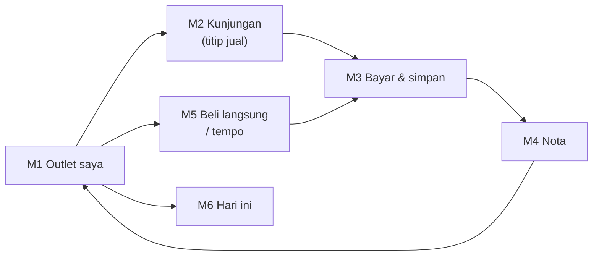

# Wireframe_dan_Mockup — SIGAP CV Arba'in

16 November 2026 · Ren (Antech Async) · Versi online: https://claude.ai/artifact/NZjEw55BUEmZzZa7SZYa8F

**Versi 2 — analisis ulang.** Kunjungan sales diringkas dari 4 layar menjadi **1 layar + 1 lembar bayar**, dengan angka yang sudah terisi. Ditambahkan layar Pengaturan, Peran & Izin, Impor Excel, dan Profil Outlet supaya sistem fleksibel tanpa programmer.

- Prototipe hi-fi saat ini: [SIGAP · Peta alur](https://www.figma.com/proto/cvBD4wgdf2jIGWW8NGOJZ7/SIGAP?node-id=329-9888&scaling=scale-down-width&hide-ui=1)
- File desain: [Figma · SIGAP · Hi-fi v2](https://www.figma.com/design/cvBD4wgdf2jIGWW8NGOJZ7/SIGAP?node-id=31-304)

## 1. Prinsip desain untuk pengguna awam

| Prinsip | Penerapan |
| --- | --- |
| Isi terlebih dahulu, ubah seperlunya | Sisa di rak sudah terisi sama dengan titipan; isi ulang sudah berisi saran. Sales hanya mengubah yang berbeda. |
| Satu layar, satu tombol utama | Tombol hijau besar di bawah; tombol lain lebih kecil dan abu-abu |
| Tanpa mengetik huruf di lapangan | Angka lewat − / + atau keypad angka; pilihan lewat tombol, bukan dropdown panjang |
| Hitungan selalu terlihat | Laku, tagihan, dan stok akhir tampil langsung saat angka diubah |
| Bahasa lapangan | Titip, sisa, laku, tarik, isi ulang, nota, belum dibayar. Kata batch, FEFO, dan sinkron tidak muncul di layar sales. |
| Warna punya arti tetap | Merah = harus ditindak (ED, sisa salah); kuning = perlu perhatian (belum dikunjungi, belum dibayar); hijau = selesai |
| Aman dari salah | Kesalahan dicegah dengan tanda merah + kalimat cara memperbaiki; kunjungan bisa diperbaiki di hari yang sama |
| Admin tetap merasa di Excel | Tabel dengan cari, filter, urutkan, impor & ekspor Excel; susunan kolom laporan sama dengan file sekarang |

### 1.1 Satu aplikasi, semua perangkat

Semua peran memakai satu aplikasi PWA. Setiap layar punya tiga susunan dari komponen yang sama:

| Perangkat | Navigasi | Tabel | Tombol utama |
| --- | --- | --- | --- |
| HP (< 640 px) | Bilah bawah, maks. 4 menu + "Lainnya" | Menjadi kartu; filter di lembar bawah | Menempel di bawah layar |
| Tablet (640–1024 px) | Menu samping bisa diciutkan | Kolom penting saja; ketuk baris untuk detail | Di kanan atas & bawah form |
| Laptop/PC (> 1024 px) | Menu samping tetap | Penuh: cari, filter, urutkan, ekspor | Di kanan atas |

**Contoh: W1 Ringkasan pimpinan di HP**

```text
+------------------------------------+
| Ringkasan        [Nov 2026 v]      |
+------------------------------------+
| Omzet bulan ini      Rp xx,x jt    |
| Kunjungan            214 / 520     |
| Belum dikunjungi     41 outlet  >  |
| Belum dibayar        9 outlet   >  |
|------------------------------------|
| Perlu tindakan                     |
| ! 18 pcs dekat kedaluwarsa      >  |
| ! 3 produk gudang di bawah min  >  |
|------------------------------------|
| Performa sales                     |
| Endri  ########----  78%           |
| Monic  ######------  61%           |
+------------------------------------+
| [Ringkasan] [Outlet] [Laporan] [..]|
+------------------------------------+
```

**Contoh: W5 Opname gudang di tablet**

```text
+----------------------------------------------------------+
| [=] Opname 16/11/2026    Hanya ubah yang beda   [Simpan] |
+----------------------------------------------------------+
| Produk               | Sistem | Fisik      | Selisih     |
| Madu Hitam Pahit 470 |   76   | [-] 76 [+] |    0        |
| Sari Kurma Alief 470 |   40   | [-] 38 [+] |   -2  [?]   |
| Flores 0,5 kg        |   55   | [-] 55 [+] |    0        |
+----------------------------------------------------------+
| Tersimpan di perangkat, terkirim saat ada sinyal         |
+----------------------------------------------------------+
```

**Contoh: profil outlet (W2) di HP** — tab menjadi tombol geser, tabel stok menjadi kartu:

```text
+------------------------------------+
| < AP SARI FARMA         [WA] [...] |
| Apotek . Surakarta . Titip jual    |
| (Stok) (Kunjungan) (Tagihan)       |
|------------------------------------|
| Madu Hitam Pahit 470               |
| Titipan 5 . Standar 5 . ED 11/2028 |
|------------------------------------|
| Sari Kurma Alief 470               |
| Titipan 3 . Standar 3 . ED 03/2027!|
+------------------------------------+
```

## 2. Inventaris layar

| Kode | Layar | Pengguna | Status |
| --- | --- | --- | --- |
| L1 | Masuk (nomor HP/username + kata sandi) | Semua | Ada di Figma — sederhanakan |
| M1 | Outlet saya | Sales | **Baru** |
| M2 | Kunjungan titip jual (satu layar) | Sales | **Baru** |
| M3 | Lembar bayar & simpan | Sales | **Baru** |
| M4 | Nota | Sales | **Baru** |
| M5 | Penjualan beli langsung / tempo | Sales | **Baru** |
| M6 | Hari ini: stok bawaan, minta barang, uang dibawa | Sales | **Baru** |
| W1 | Ringkasan pimpinan | Pimpinan | Ada (D1/D2) — **revisi** |
| W2 | Profil outlet (CRM) | Admin Kantor | **Baru** |
| W3 | Daftar outlet + penugasan | Admin Kantor | Ada (SL1–SL7) — revisi data |
| W4 | Produk & potongan | Admin Kantor | Ada (S7) — tambah potongan |
| W5 | Gudang: barang masuk, permintaan sales, retur, opname | Admin Gudang | Ada (S8) — **revisi** + opname baru |
| W6 | Tagihan & setoran | Admin Kantor | Ada (S6) — **revisi** |
| W7 | Laporan | Pimpinan, Admin Kantor | **Baru** |
| W8 | Pengaturan aturan | Admin Kantor | **Baru** |
| W9 | Peran & izin | Admin Kantor | Ada (U1/U2) — ubah ke centang izin |
| W10 | Impor Excel | Admin Kantor | **Baru** |
| W11 | Perbaiki / koreksi / batalkan / ubah status transaksi | Semua peran (sesuai izin) | Baru |
| W12 | Riwayat perubahan | Semua peran | Baru |
| W13 | Perlu dicek (konflik offline) & Tempat sampah | Admin Kantor, Admin Gudang | Baru |
| MK-W1–W8 | Layar modul maklon (lihat dokumen 06) | Tim maklon | Baru (fase maklon) |

## 3. Alur sales



Kunjungan tanpa perubahan: M1 → M2 → "Tidak ada yang laku" → selesai (3 ketukan).

## 4. Wireframe layar sales (dirancang untuk HP dulu)

### M1 — Outlet saya

```text
+--------------------------------------+
| Halo, Endri          Tersimpan di HP |
| 2 kunjungan menunggu sinyal          |
+--------------------------------------+
| [ Cari outlet...                 ]   |
| (Perlu dikunjungi 41) (Belum bayar 9)|
+--------------------------------------+
| AP SARI FARMA            Surakarta   |
| 42 hari lalu  . Belum bayar 86 rb    |
| ! 1 produk dekat kedaluwarsa         |
|--------------------------------------|
| AP BALAPAN               Surakarta   |
| 226 hari lalu  (sangat lama)         |
|--------------------------------------|
| TOYYIBA                  Surakarta   |
| Selesai hari ini            [v]      |
+--------------------------------------+
| [Outlet]   [Hari ini]   [Bantuan]    |
+--------------------------------------+
```

Catatan: diurutkan dari yang paling lama tidak dikunjungi. Satu ketukan pada baris membuka M2 (outlet titip) atau M5 (outlet beli/tempo).

### M2 — Kunjungan titip jual (satu layar)

```text
+-------------------------------------+
| < AP SARI FARMA      Apotek . 16%   |
+-------------------------------------+
| [   TIDAK ADA YANG LAKU   ]         |
| atau ubah sisa yang berkurang:      |
|-------------------------------------|
| Madu Hitam Pahit 470                |
| Sisa di rak   [-]  1  [+]  dari 4   |
| Laku 3              Isi [-] 4 [+]   |
|-------------------------------------|
| Sari Kurma Alief 470    ! ED 03/27  |
| Sisa di rak   [-]  2  [+]  dari 2   |
| Tarik [-] 1 [+]     Isi [-] 2 [+]   |
|-------------------------------------|
| Flores 0,5 kg                       |
| Sisa di rak   [-]  3  [+]  dari 3   |
|-------------------------------------|
| Laku 3 . Rp 196.560                 |
| [        LANJUT  >        ]         |
+-------------------------------------+
```

Catatan:

- Angka "Sisa" sudah terisi sama dengan titipan. Produk yang tidak berubah tidak perlu disentuh.
- "Isi" sudah berisi saran isi ulang; baris Isi dan Tarik hanya muncul bila diperlukan.
- Produk yang ditandai ED langsung mendapat saran "Tarik".
- Bila sisa lebih besar dari titipan, kotak berubah merah dengan pesan "Sisa lebih dari titipan (4). Hitung ulang?"

### M3 — Bayar & simpan (lembar bawah)

```text
+-------------------------------------+
| Tagihan kunjungan ini   Rp 196.560  |
| Belum dibayar sebelumnya Rp 86.000  |
| Total                   Rp 282.560  |
| Laku 3 (lebih dari 2): sebaiknya    |
| ditagih sekarang                    |
|                                     |
| [ DIBAYAR SEMUA ]                   |
| [ Sebagian... ]   [ Belum bayar ]   |
|                                     |
| Foto form bercap (opsional) [Kamera]|
+-------------------------------------+
```

Catatan: kalimat saran mengikuti angka di Pengaturan (mis. "lebih dari 3" bila diubah).

### M4 — Nota

```text
+-------------------------------------+
|  (v) Tersimpan                      |
| Nota NT-2611-0142 . AP SARI FARMA   |
| Madu Hitam Pahit 470  laku 3  stok 5|
| Sari Kurma Alief 470  tarik 1 stok 3|
| Dibayar Rp 282.560                  |
+-------------------------------------+
| [ Kirim ke WhatsApp ]  [ Cetak ]    |
| [ Ke outlet berikutnya > ]          |
| Salah input? [Perbaiki]             |
+-------------------------------------+
```

### M5 — Beli langsung / tempo

```text
+------------------------------------+
| < APOTEK DISTRIBUTOR X  Tempo 30 hr|
+------------------------------------+
| [ Cari / pilih produk ...       ]  |
| Madu Hitam Pahit 470  [-] 12 [+]   |
| Flores 0,5 kg         [-]  6 [+]   |
|------------------------------------|
| Total setelah potongan Rp x.xxx.xxx|
| [        LANJUT  >        ]        |
+------------------------------------+
```

### M6 — Hari ini

```text
+-------------------------------------+
| Hari ini . 16 Nov                   |
| Dikunjungi 9 / rencana 12           |
| Uang dibawa       Rp 1.240.000      |
|-------------------------------------|
| Stok bawaan                         |
| Madu Hitam Pahit 470   14           |
| Sari Kurma Alief 470    8 (+1 tarik)|
| [ Minta barang ke gudang ]          |
+-------------------------------------+
```

## 5. Wireframe layar admin & pimpinan (versi laptop/PC; di HP & tablet mengikuti pola bagian 1.1)

### W1 — Ringkasan pimpinan

```text
+----------------------------------------------------------------------------+
| Ringkasan  [November 2026 v] [Semua sales v] [Semua wilayah v]             |
+----------------------------------------------------------------------------+
| [Omzet bulan ini] [Kunjungan 214/520] [Belum dikunjungi 41] [Belum bayar]  |
+----------------------------------------------------------------------------+
| Performa sales (omzet vs target)    | Outlet paling aktif (top 10)         |
| Endri ########----  78%             | 1 Toyyiba        Rp x . 4 kunjungan  |
| Monic ######------  61%             | 2 Cahaya Herbal  Rp x . 3 kunjungan  |
+----------------------------------------------------------------------------+
| Perputaran stok (% laku)            | Perlu tindakan                       |
| Sarkum Alief 470    62%             | 18 pcs dekat kedaluwarsa  [Lihat]    |
| Madu Hitam Pahit    52%             | 3 produk gudang di bawah minimum     |
| Flores 0,5 kg       50%   lambat    | 9 outlet belum bayar > 30 hari       |
+----------------------------------------------------------------------------+
```

### W2 — Profil outlet (CRM)

```text
+---------------------------------------------------------------------------+
| AP SARI FARMA . Apotek . Surakarta, Laweyan . Titip jual   [Edit] [WA]    |
| Sales: Endri . Kunjungan terakhir 05/10 . Siklus 30 hari                  |
+---------------------------------------------------------------------------+
| [Stok titipan] [Riwayat kunjungan] [Tagihan] [Catatan]                    |
| Produk               | Titipan | Stok standar | ED terdekat | Laku 3 bln  |
| Madu Hitam Pahit 470 |    5    |      5       | 11/2028     |     9       |
| Sari Kurma Alief 470 |    3    |      3       | 03/2027 !   |     4       |
+---------------------------------------------------------------------------+
```

### W8 — Pengaturan aturan

```text
+---------------------------------------------------------------------------+
| Pengaturan                                                   [Simpan]     |
+---------------------------------------------------------------------------+
| Penagihan                                                                 |
|  Sarankan tagih bila laku lebih dari  [ 2 ] (o) unit ( ) jenis produk     |
|  Tempo untuk outlet tempo             [ 30 ] hari                         |
| Kedaluwarsa                                                               |
|  Tandai untuk ditarik bila ED kurang dari [ 6 ] bulan                     |
| Kunjungan                                                                 |
|  Outlet perlu dikunjungi setiap       [ 30 ] hari                         |
|  Foto form bercap                     ( ) Wajib  (o) Opsional             |
| Persetujuan                                                               |
|  Barang keluar gudang                 [x] perlu disetujui                 |
|  Perubahan potongan                   [x] perlu disetujui Pimpinan        |
|  Penyesuaian opname                   [ ] perlu disetujui                 |
| Daftar: [Jenis outlet] [Wilayah] [Kategori produk]                        |
+---------------------------------------------------------------------------+
| Terakhir diubah: Admin, 16/11/2026 . [Riwayat perubahan]                  |
+---------------------------------------------------------------------------+
```

### W9 — Peran & izin

```text
+----------------------------------------------------------------------------+
| Peran: [Admin Gudang v]   [+ Peran baru]  [Salin dari peran lain]          |
+----------------------------------------------------------------------------+
| Menu / aksi             | Lihat | Tambah/Ubah | Setujui |                  |
| Barang masuk            |  [x]  |    [x]      |   -     |                  |
| Permintaan barang sales |  [x]  |    [x]      |   [ ]   |                  |
| Opname                  |  [x]  |    [x]      |   [ ]   |                  |
| Outlet                  |  [ ]  |    [ ]      |   -     |                  |
+----------------------------------------------------------------------------+
```

### W10 — Impor Excel

```text
+---------------------------------------------------------------------------+
| Impor data  [Outlet v]   [Unduh template]   [Pilih file Excel]            |
+---------------------------------------------------------------------------+
| Pratinjau: 152 baris . 147 siap . 3 mirip outlet lain . 2 bermasalah      |
| Baris | Nama               | Kecamatan | Status                           |
| 15    | tk dewi murni      | Gading    | Mirip baris 14 -> [Gabung][Beda] |
| 38    | to alam jaya       | (kosong)  | Kecamatan wajib diisi            |
+---------------------------------------------------------------------------+
| [ Impor 147 baris yang siap ]                                             |
+---------------------------------------------------------------------------+
```

### W5 — Opname gudang

```text
+-------------------------------------------------------------------------------+
| Opname 16/11/2026      Hanya ubah yang berbeda                [Simpan]        |
+-------------------------------------------------------------------------------+
| Produk               | ED      | Sistem | Fisik  | Selisih | Riwayat hari ini |
| Madu Hitam Pahit 470 | 11/2028 |   76   | [ 76 ] |    0    |                  |
| Sari Kurma Alief 470 | 09/2027 |   40   | [ 38 ] |   -2    | Keluar Endri 10  |
+-------------------------------------------------------------------------------+
| Alasan selisih: [______________________]                                      |
+-------------------------------------------------------------------------------+
```

### W7 — Laporan

```text
+------------------------------------------------------------------------------+
| Laporan [Bulan v] [Sales v] [Kabupaten v] [Jenis outlet v]  [Excel] [PDF]    |
+------------------------------------------------------------------------------+
| ANALITIK            | Performa sales . Outlet paling aktif . Perputaran stok |
| LAPORAN BULANAN     | Kunjungan . Penjualan J/R/L . Setor outlet             |
|                     | Stok di outlet . Outlet belum dikunjungi               |
| GUDANG              | Opname harian . Keluar-masuk sales . Kedaluwarsa       |
| HARGA               | Daftar harga & potongan                                |
+------------------------------------------------------------------------------+
```

### W11 — Perbaiki / koreksi transaksi (berlaku di semua modul)

Setiap halaman detail transaksi punya tombol **Perbaiki**, **Ubah status**, **Batalkan**, dan **Riwayat**. Tombol yang muncul menyesuaikan izin dan batas waktu di Pengaturan.

```text
+--------------------------------------------------------------------------+
| Kunjungan KJ-2611-0142 . AP SARI FARMA . Endri . 16/11 09:12             |
| Status: AKTIF        [Perbaiki] [Ubah status v] [Batalkan] [Riwayat]     |
+--------------------------------------------------------------------------+
| Ajukan koreksi (lewat batas waktu perbaikan langsung)                    |
| Produk               | Sebelum: sisa | Sesudah: sisa | Laku baru         |
| Madu Hitam Pahit 470 |      11       |   [  1  ]     |    3              |
| Alasan (wajib): [Salah ketik saat kunjungan_____________________]        |
| Dampak: stok outlet -10, tagihan +Rp 655.200                             |
|                         [Batal]  [Ajukan koreksi -> perlu persetujuan]   |
+--------------------------------------------------------------------------+
```

Catatan: sebelum disimpan, sistem selalu menampilkan **dampak** koreksi (stok, tagihan) dengan kalimat biasa, supaya pengguna yakin sebelum menekan simpan.

### W12 — Riwayat perubahan

```text
+--------------------------------------------------------------------------+
| Riwayat . KJ-2611-0142                                                   |
+--------------------------------------------------------------------------+
| 16/11 09:12  Endri       Membuat kunjungan                               |
| 16/11 15:40  Admin Rina  Koreksi: sisa Madu Hitam Pahit 11 -> 1          |
|                          Alasan: Salah ketik saat kunjungan              |
| 16/11 16:02  Pimpinan    Menyetujui koreksi                              |
+--------------------------------------------------------------------------+
```

### W13 — Perlu dicek & Tempat sampah

```text
+--------------------------------------------------------------------------+
| Perlu dicek (3)                  | Tempat sampah (dipulihkan <= 30 hari) |
|----------------------------------|---------------------------------------|
| KJ-2611-0150 Toyyiba             | Outlet "tk era jaya"  dihapus 12/11   |
| Titipan di HP 4, di server 2     |   oleh Admin Rina      [Pulihkan]     |
| (dikunjungi Endri & Monic)       | Pembayaran PB-0091    dihapus 10/11   |
| [Pakai data HP] [Pakai server]   |   oleh Endri           [Pulihkan]     |
| [Sesuaikan manual]               |                                       |
|----------------------------------|---------------------------------------|
| Gagal kirim dari HP: Monic (2)   |                                       |
| terakhir terkirim 15/11 18:20    |                                       |
+--------------------------------------------------------------------------+
```

Layar modul maklon (papan order, detail order, jadwal produksi, tagihan bertahap) ada di dokumen 06\_Rancangan\_Modul\_Maklon, bagian 8.

## 6. Revisi prototipe Figma

| # | Layar Figma | Revisi |
| --- | --- | --- |
| R1 | Alur "1 · Sales (HP)" | Ganti alur pesanan dengan M1–M6 |
| R2 | S6 Kelola pesanan + ACC | Jadi W6 Tagihan & setoran; hapus ACC pesanan |
| R3 | S8 Pengiriman & telusur batch | Jadi "Permintaan barang sales"; batch dipilih otomatis, persetujuan satu klik |
| R4 | SL1–SL7 Sales & target | Data contoh Endri & Monic; outlet per kabupaten |
| R5 | D1/D2 Dashboard | Jadi W1: performa sales, outlet paling aktif, perputaran stok, perlu tindakan |
| R6 | U1/U2 Akun & peran | Jadi W9: centang izin per menu/aksi, peran baru bisa dibuat |
| R7 | Baru | W2 Profil outlet, W5 Opname, W7 Laporan, W8 Pengaturan, W10 Impor Excel |
| R8 | P0 Peta alur | Tambah alur demo end-to-end sesuai skenario uji SRS §7 |
| R9 | Semua layar | Buat varian HP, tablet, dan laptop/PC untuk setiap layar (pola bagian 1.1); satu PWA untuk semua peran |
| R10 | Semua halaman detail | Tambah tombol Perbaiki, Ubah status, Batalkan, Riwayat; layar W11–W13; layar maklon MK-W1–W8 |

## 7. Uji kemudahan yang disarankan

| Tugas | Peserta | Target |
| --- | --- | --- |
| Catat kunjungan tanpa perubahan | Sales | ≤ 15 detik, tanpa bantuan |
| Catat kunjungan dengan 3 produk laku + 1 tarik ED | Sales | ≤ 2 menit, tanpa salah hitung |
| Kirim nota ke WhatsApp outlet | Sales | Tanpa bantuan |
| Temukan outlet yang belum dikunjungi bulan ini | Pimpinan | ≤ 10 detik |
| Ubah batas tagih dari 2 ke 3 | Admin | ≤ 1 menit |
| Impor 20 outlet dari Excel | Admin | ≤ 5 menit |

Uji dilakukan dengan prototipe Figma bersama Endri, Monic, dan satu admin; catat di mana mereka ragu, lalu perbaiki sebelum dikembangkan.
