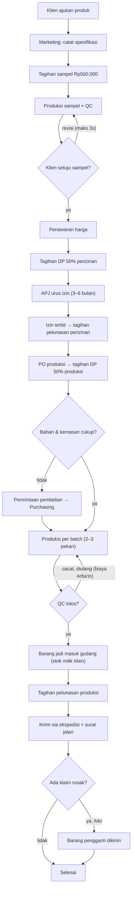
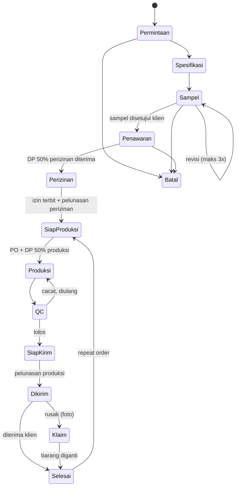
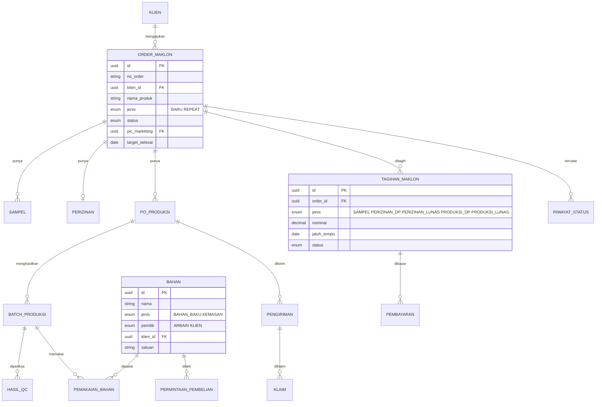

# Rancangan_Modul_Maklon — SIGAP CV Arba'in

16 November 2026 · Ren (Antech Async) · Versi online: https://claude.ai/artifact/FenGBBmvNCrGrUYsKE8AUp

Modul maklon melacak pesanan produksi untuk brand milik klien, mulai dari permintaan, sampel, perizinan, dan produksi, sampai pengiriman dan repeat order. Di dalamnya termasuk siapa yang mengerjakan tiap tahap, bahan yang dipakai, dan tagihan DP/pelunasan. Modul ini memakai fondasi yang sama dengan SIGAP inti: satu PWA, peran & izin, Pengaturan, persetujuan umum, buku besar stok, dan fitur koreksi. Sesuai brief, modul ini dibangun **setelah purwarupa inti**, tetapi struktur datanya sudah disiapkan sejak awal agar tidak perlu bongkar ulang.

## 1. Sumber & fakta dari mitra (QnA ARB-02)

| Aspek | Jawaban mitra |
| --- | --- |
| Alur | Klien → Marketing (spesifikasi) → sampel & penawaran → DP 50% biaya perizinan → izin (3–6 bulan) → produksi (2–3 pekan) |
| PIC | Marketing, APJ (Apoteker Penanggung Jawab), Purchasing, Admin Gudang, Kepala Produksi, QC, Keuangan |
| Durasi tahap internal | ± 1 pekan per tahap |
| Biaya sampel | Rp500.000, maksimal 3× revisi, menjadi deposit |
| Biaya perizinan | Rp7.500.000: DP 50% di awal, pelunasan 50% saat izin terbit |
| Biaya produksi | DP 50% saat PO, pelunasan 50% saat siap kirim; produksi mulai setelah izin terbit **dan** PO |
| Bahan | Admin Gudang mengecek atas permintaan Kepala Produksi; bila kosong → Purchasing membeli |
| Kemasan | Dibelikan Arba'in, disimpan di gudang yang sama dengan kartu stok terpisah |
| Sisa bahan | Milik pihak yang membeli |
| Cacat produksi | Diulang dengan biaya Arba'in |
| Pengiriman | Setelah pelunasan, via ekspedisi, ongkir ditanggung klien, disertai surat jalan |
| Klaim rusak | Klien kirim foto → barang diganti |
| Repeat order | Produksi terjadwal, disimpan di gudang Arba'in, dicatat terpisah, ditagih saat siap kirim |
| Keuangan | Membuat tagihan, cek uang masuk, pembukuan |

## 2. Pengguna & peran

Peran berikut dibuat dari menu Peran & Izin, tanpa programmer. Satu orang boleh merangkap beberapa peran.

| Peran | Yang dikerjakan di SIGAP | Perangkat utama |
| --- | --- | --- |
| Marketing | Daftarkan klien & order, catat spesifikasi, sampel, penawaran, jadwal repeat order | HP / laptop |
| APJ | Kelola tahap perizinan: dokumen, nomor izin, tanggal terbit | Laptop |
| Kepala Produksi | Jadwal produksi, minta bahan, catat hasil produksi per batch | Tablet / PC |
| QC | Catat hasil QC sampel & batch: lolos / cacat + foto | Tablet / HP |
| Admin Gudang | Cek & keluarkan bahan, terima barang jadi milik klien, siapkan pengiriman | PC / tablet |
| Purchasing | Proses permintaan pembelian bahan/kemasan | Laptop |
| Keuangan | Terbitkan tagihan, catat pembayaran, buka "kunci" tahap setelah DP/pelunasan | Laptop |
| Pimpinan | Pantau semua order, nilai tagihan, order terlambat | HP / laptop |
| Klien (opsional, fase berikut) | Lihat status order & tagihan lewat tautan khusus tanpa login | HP |

## 3. Alur proses maklon



**Gerbang pembayaran.** SIGAP tidak mengizinkan tahap berikutnya dimulai sebelum syaratnya terpenuhi: perizinan setelah DP perizinan lunas, produksi setelah izin terbit **dan** DP produksi lunas, pengiriman setelah pelunasan produksi. Bila pimpinan ingin memberi kelonggaran untuk klien tertentu, gerbang bisa dibuka manual dengan alasan dan tercatat di riwayat.

## 4. Status order



Setiap perpindahan status tercatat di `riwayat_status` (siapa, kapan, dari–ke, alasan). Status yang salah bisa dikembalikan ke status sebelumnya lewat fitur koreksi (bagian 9).

## 5. Kebutuhan fungsional (MK)

| ID | Kebutuhan | Prioritas fase maklon |
| --- | --- | --- |
| MK-01 | Data klien: nama perusahaan/brand, PIC, kontak WA, alamat kirim, NPWP (opsional) | M |
| MK-02 | Order maklon: produk, spesifikasi (komposisi, kemasan, ukuran, jumlah), PIC Marketing, target tanggal | M |
| MK-03 | Sampel: nomor revisi, tanggal, hasil QC, keputusan klien; sistem menolak revisi ke-4 kecuali dibuka dengan alasan | M |
| MK-04 | Penawaran: harga per unit, minimal order, masa berlaku; bisa dicetak/dibagikan PDF | M |
| MK-05 | Perizinan: nomor pengajuan, dokumen terlampir, tanggal pengajuan, tanggal terbit, nomor izin, masa berlaku izin + pengingat sebelum habis | M |
| MK-06 | PO produksi: jumlah, jadwal, harga; DP dan pelunasan dihitung otomatis dari persentase di Pengaturan | M |
| MK-07 | Kebutuhan bahan per produk (resep/BOM) dan cek ketersediaan otomatis saat PO dibuat | S |
| MK-08 | Permintaan bahan oleh Kepala Produksi → Admin Gudang mengeluarkan; kekurangan otomatis jadi permintaan pembelian ke Purchasing | M |
| MK-09 | Stok bahan & kemasan dengan **pemilik** (Arba'in atau klien X), kartu stok terpisah per pemilik | M |
| MK-10 | Hasil produksi per batch (nomor batch, ED, jumlah) masuk gudang sebagai stok milik klien | M |
| MK-11 | QC per batch: lolos / cacat, jumlah, foto, tindakan (ulang produksi); biaya ulang ditandai "ditanggung Arba'in" | M |
| MK-12 | Tagihan otomatis per tahap: sampel, DP perizinan, pelunasan perizinan, DP produksi, pelunasan produksi; pembayaran sebagian diperbolehkan | M |
| MK-13 | Gerbang tahap: tahap berikut terkunci sampai tagihan syaratnya lunas; buka manual dengan alasan oleh pemegang izin | M |
| MK-14 | Pengiriman: ekspedisi, nomor resi, ongkir (dibebankan ke klien), surat jalan PDF, foto serah terima | M |
| MK-15 | Klaim: foto dari klien, jumlah rusak, keputusan, pengiriman pengganti | M |
| MK-16 | Repeat order: salin dari order sebelumnya (spesifikasi, izin, harga), jadwalkan produksi berkala, tagihan saat siap kirim | M |
| MK-17 | Papan order (kanban) per status + tampilan kalender/timeline jadwal produksi | S |
| MK-18 | Laporan: order per status, order terlambat, nilai tagihan belum lunas, biaya ulang produksi, stok milik klien | M |
| MK-19 | Tautan status untuk klien (hanya baca) | C |

## 6. Aturan yang bisa diatur (Pengaturan)

| Kunci | Nilai awal | Keterangan |
| --- | --- | --- |
| `maklon_biaya_sampel` | 500000 | Menjadi deposit bila order lanjut |
| `maklon_maks_revisi_sampel` | 3 | Lebih dari ini perlu buka manual |
| `maklon_biaya_perizinan` | 7500000 | Bisa berbeda per order (diisi saat penawaran) |
| `maklon_dp_perizinan_persen` | 50 |  |
| `maklon_dp_produksi_persen` | 50 |  |
| `maklon_gerbang_bayar` | true | Kunci tahap sampai pembayaran syarat lunas |
| `maklon_pengingat_izin_hari` | 90 | Pengingat sebelum izin habis |
| `maklon_target_tahap_hari` | 7 | Dipakai untuk menandai order terlambat |

## 7. Model data



**Integrasi dengan SIGAP inti:**

| Bagian inti | Dipakai ulang untuk maklon |
| --- | --- |
| `lokasi_stok`, `saldo_stok`, `mutasi_stok` | Kolom baru `pemilik_id` (null = Arba'in). Bahan, kemasan, dan barang jadi klien memakai buku besar yang sama, tetapi saldonya tidak pernah tercampur dengan stok Arba'in. |
| `batch` | Batch produk klien memakai tabel yang sama, ditandai pemiliknya |
| `tagihan`, `pembayaran` | Tagihan maklon memakai mekanisme yang sama; jenis tagihan bertambah |
| `persetujuan` | Buka gerbang manual, revisi sampel ke-4, penyesuaian stok bahan |
| `pengaturan` | Kunci `maklon_*` di bagian 6 |
| `peran_izin` | Izin baru: `maklon.lihat`, `maklon.ubah`, `maklon.qc`, `maklon.buka_gerbang`, `pembelian.proses` |
| Koreksi & riwayat | Semua koreksi di bagian 9 berlaku juga untuk maklon |

## 8. Layar utama

| Kode | Layar | Pengguna |
| --- | --- | --- |
| MK-W1 | Papan order maklon (kanban per status) + filter klien/PIC | Marketing, Pimpinan |
| MK-W2 | Detail order: lini masa tahap, tagihan, dokumen, riwayat | Semua peran maklon |
| MK-W3 | Sampel & QC | Marketing, QC |
| MK-W4 | Perizinan | APJ |
| MK-W5 | Jadwal produksi & permintaan bahan | Kepala Produksi, Admin Gudang |
| MK-W6 | Permintaan pembelian | Purchasing |
| MK-W7 | Tagihan maklon | Keuangan |
| MK-W8 | Pengiriman & klaim | Admin Gudang, Marketing |

**MK-W1 — Papan order (laptop/PC; di HP tiap kolom menjadi tab)**

```text
+-----------------------------------------------------------------------------------+
| Order maklon   [Cari klien/produk]   [PIC: Semua v]   [+ Order baru]              |
+-----------------------------------------------------------------------------------+
| Sampel (3)      | Perizinan (4)     | Siap produksi (2) | Produksi (2) | Kirim (1)|
|-----------------|-------------------|-------------------|--------------|----------|
| MK-2611-07      | MK-2608-03        | MK-2607-01        | MK-2605-02   | MK-2604  |
| Brand A Madu    | Brand C Herbal    | Brand E Kurma     | Brand F VCO  | Brand G  |
| Revisi 2 dari 3 | 47 hari . DP ok   | ! DP produksi     | QC besok     | Lunas    |
|                 |                   |   belum dibayar   |              | Resi ... |
+-----------------------------------------------------------------------------------+
```

**MK-W2 — Detail order**

```text
+---------------------------------------------------------------------------------+
| < MK-2607-01 . Brand E Kurma 330 ml . Klien: PT Contoh . PIC: Marketing A       |
| Status: SIAP PRODUKSI   [Ubah status v]   [Perbaiki data]   [Riwayat]           |
+---------------------------------------------------------------------------------+
| Lini masa                                                                       |
| (v) Spesifikasi  (v) Sampel r2  (v) Penawaran  (v) Perizinan  ( ) Produksi ...  |
|---------------------------------------------------------------------------------|
| Tagihan                          | Nominal      | Status                        |
| Sampel                           | Rp   500.000 | Lunas (jadi deposit)          |
| DP perizinan 50%                 | Rp 3.750.000 | Lunas                         |
| Pelunasan perizinan              | Rp 3.750.000 | Lunas                         |
| DP produksi 50%                  | Rp x.xxx.xxx | Belum dibayar  [Catat bayar]  |
|---------------------------------------------------------------------------------|
| ! Produksi terkunci sampai DP produksi lunas.   [Buka manual + alasan]          |
+---------------------------------------------------------------------------------+
```

**MK-W5 — Jadwal produksi & bahan (tablet)**

```text
+----------------------------------------------------------+
| [=] Produksi pekan 47           [+ Jadwalkan]            |
+----------------------------------------------------------+
| Sen 16 | MK-2605-02 Brand F VCO   batch F-2611 . 2.000   |
| Rab 18 | MK-2607-01 Brand E Kurma (terkunci: DP)         |
|----------------------------------------------------------|
| Bahan untuk F-2611          | Butuh | Ada  | Status      |
| VCO curah (milik klien F)   | 250 L | 260 L| Cukup       |
| Botol 125 ml (Arba'in)      | 2.000 | 1.400| Kurang 600  |
| [ Minta bahan ]  [ Ajukan pembelian kekurangan ]         |
+----------------------------------------------------------+
```

## 9. Koreksi kesalahan di modul maklon

| Kesalahan | Cara memperbaiki | Jejak |
| --- | --- | --- |
| Status order salah / maju terlalu cepat | "Ubah status" ke status sebelumnya + alasan; tagihan & gerbang dihitung ulang | `riwayat_status` |
| Data spesifikasi, harga, atau tanggal salah | "Perbaiki data"; bila order sudah ada tagihan lunas, perubahan harga butuh persetujuan | Activity log (sebelum/sesudah) |
| Tagihan salah nominal | Batalkan tagihan (bukan hapus) lalu terbitkan ulang; pembayaran yang sudah masuk dipindah ke tagihan baru | Tagihan lama berstatus BATAL + alasan |
| Pembayaran salah catat | Batalkan pembayaran + alasan, catat ulang | Pembayaran lama tetap terlihat, dicoret |
| Hasil produksi/QC salah jumlah | Mutasi penyesuaian pada batch; jumlah lama tetap tersimpan | `mutasi_stok` jenis PENYESUAIAN |
| Bahan salah pemilik (Arba'in vs klien) | Mutasi pindah pemilik + alasan, perlu persetujuan | `mutasi_stok` + `persetujuan` |
| Order terhapus tidak sengaja | Pulihkan dari Tempat Sampah (30 hari) | Soft delete |

## 10. Tahapan pembangunan modul maklon

| Tahap | Isi |
| --- | --- |
| M1 | Klien, order, sampel, penawaran, status & riwayat, tagihan + gerbang pembayaran |
| M2 | Perizinan + pengingat masa berlaku izin |
| M3 | Bahan & kemasan dengan pemilik, permintaan bahan, permintaan pembelian |
| M4 | Produksi per batch, QC, barang jadi milik klien, pengiriman, klaim |
| M5 | Repeat order terjadwal, papan kanban, laporan, tautan status klien |

## 11. Pertanyaan terbuka untuk mitra

1. Apakah biaya perizinan selalu Rp7.500.000, atau berbeda per jenis produk/izin?
2. Apakah deposit sampel Rp500.000 dipotongkan ke tagihan perizinan atau produksi?
3. Apakah sudah ada daftar bahan per produk (resep/BOM) yang bisa diimpor?
4. Dokumen apa saja yang wajib dilampirkan untuk perizinan (agar bisa jadi daftar centang di SIGAP)?
5. Apakah klien perlu bisa melihat status ordernya sendiri?
