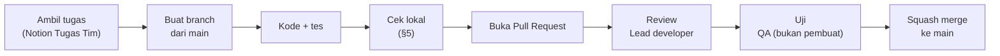

# Konvensi_Kerja_Tim — SIGAP CV Arba'in

17 November 2026 · Antech Async · Berlaku untuk semua anggota yang menulis kode atau dokumen di repo ini

Tujuannya sederhana: dengan 4 orang dan waktu sempit menuju Demo Day (28–29 Nov 2026), `main` harus **selalu bisa didemokan**. Aturan di bawah dibuat seringan mungkin untuk menjaga hal itu.

## 1. Alur kerja singkat



1. Satu tugas di Notion = satu branch = satu Pull Request.
2. Jangan push langsung ke `main`. Semua perubahan lewat Pull Request.
3. Ukuran Pull Request **≤ 400 baris yang berubah**, di luar file hasil generator dan lock file. Lebih besar → pecah.
4. Merge memakai **Squash and merge**, sehingga satu PR menjadi satu commit rapi di `main`.

## 2. Branch

Format: `<jenis>/<modul>-<ringkasan-pendek>`, huruf kecil, dipisah tanda hubung.

| Jenis | Untuk | Contoh |
| --- | --- | --- |
| `fitur/` | Fitur baru | `fitur/kunjungan-simpan-offline` |
| `perbaikan/` | Memperbaiki bug | `perbaikan/tagihan-pembulatan-potongan` |
| `rapikan/` | Refactor tanpa ubah perilaku | `rapikan/gudang-action-mutasi` |
| `dok/` | Dokumen saja | `dok/pedoman-ui-stepper` |
| `infra/` | CI, konfigurasi, dependensi | `infra/ci-github-actions` |

Hapus branch setelah di-merge.

## 3. Pesan commit

Memakai format **Conventional Commits**, dengan deskripsi berbahasa Indonesia, kalimat perintah, huruf kecil, tanpa titik di akhir.

```text
<tipe>(<modul>): <apa yang dilakukan>

<opsional: kenapa, dan kode kebutuhan SRS>
```

| Tipe | Arti |
| --- | --- |
| `feat` | Fitur baru |
| `fix` | Perbaikan bug |
| `refactor` | Ubah struktur kode tanpa ubah perilaku |
| `test` | Tambah/ubah tes saja |
| `docs` | Dokumen |
| `style` | Format kode (Pint/Prettier), tanpa ubah logika |
| `chore` | Dependensi, konfigurasi, CI |

Contoh yang baik:

```text
feat(kunjungan): hitung laku dan saran isi ulang saat sisa diubah

Mengikuti SDD §4.1 langkah 3–6. Kebutuhan: KS-03, KS-05.
```

Hindari pesan seperti `update`, `fix bug`, `wip`, atau `perubahan`. Pesan commit adalah catatan untuk anggota tim berikutnya (dan juri) tentang **apa** dan **kenapa**.

Nama `<modul>` sama dengan modul di [08_Struktur_Folder](08_Struktur_Folder.md): `outlet`, `produk`, `gudang`, `kunjungan`, `tagihan`, `laporan`, `pengaturan`, `akses`, `maklon`, ditambah `core`, `ui`, `offline`, `api`, `infra`, `docs`.

## 4. Pull Request

Template otomatis muncul saat membuka PR ([.github/pull_request_template.md](../../.github/pull_request_template.md)). Isi yang wajib:

- **Ringkasan** 1–3 kalimat dan **kode kebutuhan** SRS (mis. KS-03) atau layar (mis. M2).
- **Cara menguji** langkah demi langkah, supaya QA bisa mengulang tanpa bertanya.
- **Tangkapan layar** untuk perubahan tampilan: HP 360 px dan desktop 1280 px.
- Daftar periksa terisi.

| Peran | Tugas di PR | Orang |
| --- | --- | --- |
| Pembuat | Membuka PR, menjawab komentar | Siapa saja |
| Reviewer kode | Menyetujui isi kode, arsitektur, dan keamanan | Lead developer (Ridwan) |
| Penguji | Menjalankan "Cara menguji", lulus/tidak lulus | QA (Reza); bila PR milik Reza → anggota lain |

Aturan tim tetap berlaku: **yang membangun tidak menguji karyanya sendiri**. PR boleh di-merge setelah ada 1 persetujuan reviewer + 1 tanda lulus dari penguji.

Gunakan **Draft PR** untuk pekerjaan yang belum selesai tetapi ingin diperlihatkan.

## 5. Pemeriksaan sebelum membuka PR

Jalankan dari folder masing-masing. Semua harus lulus.

**Backend** (`backend/`)

```bash
php vendor/bin/pint             # rapikan format
php vendor/bin/phpstan analyse  # analisis statis (Larastan)
php vendor/bin/pest             # tes
```

**Frontend** (`frontend/`)

```bash
npm run lint        # oxlint
npm run typecheck   # TypeScript
npm run test        # Vitest
npm run build       # memastikan bisa di-build
```

## 6. Definisi selesai (Definition of Done)

Sebuah tugas dianggap selesai bila:

- [ ] Perilaku sesuai kebutuhan SRS/wireframe yang dirujuk; aturan angka dibaca dari Pengaturan, tidak ditulis mati
- [ ] Logika bisnis ada di Action dan punya tes (Pest) untuk kasus normal + minimal satu kasus batas
- [ ] Endpoint dicek izinnya di server (bukan hanya disembunyikan di tampilan)
- [ ] Tampilan mengikuti [07_Pedoman_UI_UX](07_Pedoman_UI_UX.md) §12 (daftar periksa UI)
- [ ] Layar sales tetap jalan tanpa sinyal bila termasuk pekerjaan lapangan (PW-05)
- [ ] Pemeriksaan §5 lulus, PR disetujui reviewer dan lulus uji QA
- [ ] Dokumen diperbarui bila keputusan berubah (atau ADR baru di `docs/adr/`)

## 7. Menjalankan secara lokal

Prasyarat: PHP 8.5, Composer 2, Node.js 26 LTS, MySQL 8.4+ (lihat README).

```bash
# Backend — http://127.0.0.1:8000
cd backend
composer install
cp .env.example .env          # sesuaikan DB_* dengan MySQL lokal
php artisan key:generate
php artisan migrate
php artisan serve

# Frontend — http://localhost:5173 (permintaan /api diteruskan ke backend)
cd frontend
npm install
npm run dev
```

## 8. Data, rahasia, dan dependensi

- Ikuti **Aturan repo** di README: tidak ada data mitra asli, BPOM contoh memakai `TR-CONTOH-`, rahasia hanya di `.env`.
- Menambah paket Composer/npm baru harus disebut di deskripsi PR beserta alasannya. Utamakan library yang sudah dipilih di SDD §1.3; bila berbeda, tulis ADR.
- File hasil generator tidak diedit manual: `frontend/src/routeTree.gen.ts`, `frontend/src/lib/api/generated/`, `docs/api/openapi.json`.
- `composer.lock` dan `package-lock.json` **ikut di-commit**.

## 9. Issue

Gunakan template di GitHub (**Fitur** atau **Bug**). Tugas harian tetap dikelola di Notion Tugas Tim; issue GitHub dipakai untuk bug dan hal teknis yang perlu dilacak bersama kode. Rujuk issue di PR dengan `Menutup #12`.
