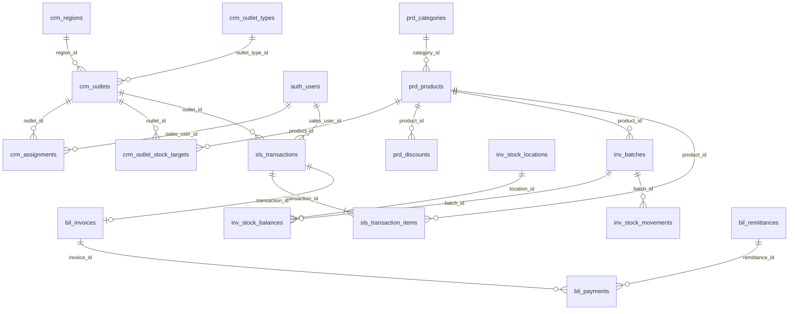

# Arsitektur_Basis_Data — SIGAP CV Arba'in

18 November 2026 · Antech Async · Turunan dari dokumen 04 (System Design) §3–§4 dan 06 (Maklon) §7 · Keputusan: [ADR 0002](../adr/0002-kode-inggris-dan-prefix-tabel.md)

Dokumen ini adalah **sumber kebenaran untuk nama tabel dan kolom**. Dokumen 04 dan 06 menjelaskan konsepnya dalam Bahasa Indonesia (`transaksi`, `saldo_stok`, …). Saat menulis migrasi, pakai nama di dokumen ini.

## 1. Tiga aturan utama

1. **Kode dan basis data memakai Bahasa Inggris. Tampilan memakai Bahasa Indonesia.** Nama tabel, kolom, kelas, fungsi, variabel, rute API, nama izin, nilai enum, dan komentar kode ditulis dalam Bahasa Inggris. Teks yang dibaca pengguna, seperti label, pesan galat, isi notifikasi, dan label izin/peran, tetap berbahasa Indonesia. Padanan istilah ada di §7.
2. **Tabel satu kelompok memakai prefix yang sama.** Prefix menunjukkan modul pemilik tabel. Saat membuka daftar tabel di phpMyAdmin/TablePlus, tabel satu modul otomatis berkumpul.
3. **Hanya modul pemilik yang menulis ke tabelnya.** Modul lain boleh membaca atau memasang foreign key, tetapi perubahan data harus lewat Action atau Event modul pemilik (dokumen 08 §2).

## 2. Prefix per kelompok

| Prefix | Kelompok | Modul backend (`app/Modules/…`) | Scope commit | Folder frontend (`src/features/…`) |
| --- | --- | --- | --- | --- |
| `sys_` | Infrastruktur framework: migrasi, cache, antrean, log audit | — (konfigurasi `config/`) | `infra` | — |
| `auth_` | Pengguna, peran, izin, token perangkat | `Auth` | `auth` | `auth` |
| `core_` | Mekanisme lintas modul: persetujuan, status, impor, tutup buku | `app/Core` | `core` | — |
| `cfg_` | Pengaturan aturan bisnis dan field kustom | `Setting` | `setting` | `setting` |
| `crm_` | Outlet (pelanggan B2B), wilayah, penugasan sales | `Outlet` | `outlet` | `outlet` |
| `prd_` | Produk, kategori, potongan | `Product` | `product` | `product` |
| `inv_` | Gudang dan stok: lokasi, batch, saldo, mutasi, dokumen gudang | `Inventory` | `inventory` | `inventory` |
| `sls_` | Kunjungan titip jual dan penjualan langsung | `Sales` | `sales` | `sales` |
| `bil_` | Tagihan, pembayaran, setoran | `Billing` | `billing` | `billing` |
| `rpt_` | Dicadangkan untuk tabel rekap laporan bila nanti dibutuhkan | `Report` | `report` | `report` |
| `mfg_` | Maklon (fase 4, dokumen 06) | `Manufacturing` | `manufacturing` | `manufacturing` |

Prefix ditulis huruf kecil, 3–4 huruf, lalu garis bawah. Jangan membuat prefix baru tanpa ADR.

## 3. Aturan penamaan

| Hal | Aturan | Contoh |
| --- | --- | --- |
| Tabel | `<prefix>_<benda_jamak>`, snake_case | `crm_outlets`, `inv_stock_movements` |
| Tabel rincian (header–detail) | `<prefix>_<induk_tunggal>_items` | `sls_transaction_items`, `inv_goods_receipt_items` |
| Kunci utama | `id`. Tabel bisnis (`core_` sampai `mfg_`) memakai **ULID** (`$table->ulid('id')->primary()`), sehingga aman dibuat di banyak perangkat dan mudah digabung. Tabel `sys_` dan `auth_` memakai bawaan paket (bigint) | — |
| Kunci asing | `<benda_tunggal>_id`. Bila ada dua FK ke tabel yang sama atau perannya perlu jelas, tambahkan peran di depan | `outlet_id`, `sales_user_id`, `from_location_id` |
| FK ke pengguna | `<peran>_user_id` atau kolom audit `created_by`, `updated_by`, `approved_by` (semuanya FK ke `auth_users`) | `sales_user_id`, `received_by` |
| Boolean | `is_…` / `has_…` / `needs_…` | `is_active`, `needs_review` |
| Waktu lengkap | `…_at` (timestamp) | `transacted_at`, `voided_at` |
| Tanggal saja | `…_date` | `expiry_date`, `due_date` |
| Jumlah barang | `…_qty`, integer. Tanpa tanda (`unsignedInteger`) kecuali selisih/penyesuaian | `sold_qty`, `difference_qty` |
| Uang | `decimal(15, 2)`. Nama tanpa "rp" | `unit_price`, `total` |
| Persen | `decimal(5, 2)`, akhiran `_percent` | `discount_percent` |
| Enum/status | `string` (varchar 30), nilai snake_case Bahasa Inggris. Label Indonesia diambil dari PHP enum `label()` | `consignment` → "Titip jual" |
| Salinan data saat transaksi | Nama kolom asli + konteks, disimpan agar transaksi lama tidak ikut berubah | `product_name`, `unit_price` di `sls_transaction_items` |
| Penghapusan | Data master: soft delete (`deleted_at`). Dokumen transaksi: **tidak dihapus**; status `void` + alasan | — |
| Penggabungan data dobel | `merged_into_id` (FK ke tabel yang sama) | `crm_outlets.merged_into_id` |
| JSON | Hanya untuk data yang bentuknya bebas: field kustom, salinan data dari HP | `custom_fields`, `client_payload` |
| Indeks & constraint | Nama otomatis Laravel (sudah mengandung prefix). Jangan menulis nama manual kecuali terlalu panjang (> 64 karakter MySQL) | `crm_outlets_region_id_foreign` |
| File migrasi | `YYYY_MM_DD_HHMMSS_create_<tabel>_table.php`; perubahan: `…_add_<kolom>_to_<tabel>_table.php` | `2026_11_20_000100_create_inv_batches_table.php` |
| Model Eloquent | Nama tunggal tanpa prefix, di modul pemilik, **wajib** menulis `$table` | `App\Modules\Outlet\Models\Outlet` → `protected $table = 'crm_outlets';` |

Tabel milik paket pihak ketiga diberi prefix lewat konfigurasinya, bukan dengan mengubah kode paket. Contohnya `config/permission.php`, `config/queue.php`, `config/cache.php`, `config/session.php`, `config/auth.php`, `config/database.php` (`sys_migrations`), dan model token Sanctum di `Modules/Auth/Models/PersonalAccessToken`.

## 4. Peta relasi inti

## 5. Katalog tabel

Kolom **Status**: **ada** = sudah ada migrasinya; **MVP** = dibuat untuk purwarupa hackathon (SDD §11 tahap 1); **nanti** = setelah purwarupa. Kolom `id`, `created_at`, dan `updated_at` tidak ditulis ulang.

### 5.1 `sys_` — infrastruktur framework

| Tabel | Isi | Status |
| --- | --- | --- |
| `sys_migrations` | Catatan migrasi Laravel | ada |
| `sys_cache`, `sys_cache_locks` | Cache dan kunci (driver database) | ada |
| `sys_jobs`, `sys_job_batches`, `sys_failed_jobs` | Antrean (driver database) | ada |
| `sys_activity_log` | Riwayat perubahan: siapa, kapan, nilai lama/baru (spatie/laravel-activitylog, AK-03). Atur `table_name` di `config/activitylog.php` sebelum migrasi | MVP |
| `sys_push_subscriptions` | Langganan Web Push per perangkat (PW-08). Atur `table_name` di config webpush | nanti |
| `sys_features` | Feature flag Laravel Pennant. Atur `stores.database.table` di `config/pennant.php` | nanti |

### 5.2 `auth_` — pengguna dan akses

| Tabel | Kolom penting | Status |
| --- | --- | --- |
| `auth_users` | `name`, `username` (unik, 3–50 karakter huruf/angka/`.`/`_`, wajib ada huruf agar tidak tertukar dengan nomor HP; `Login::USERNAME_PATTERN`), `phone` (unik, format `08…`), `email`, `is_active`, `last_login_at`, `password` | ada |
| `auth_personal_access_tokens` | Token Sanctum; satu token = satu perangkat (`name` = nama perangkat). Kolom `last_synced_at` ditambah saat modul sinkron dibuat | ada |
| `auth_roles`, `auth_permissions` | Peran dan izin (spatie/laravel-permission) | ada |
| `auth_model_has_roles`, `auth_model_has_permissions`, `auth_role_has_permissions` | Tabel penghubung spatie | ada |
| `auth_password_reset_tokens`, `auth_sessions` | Bawaan Laravel | ada |

Nama izin: `<resource>.<action>`, misalnya `outlet.manage` atau `discount.approve`. Daftar lengkap beserta label Indonesianya ada di `App\Modules\Auth\Permissions`. Izin `outlet.view_all` membedakan siapa yang melihat semua outlet (Pimpinan, Admin Kantor) dan siapa yang hanya melihat outlet tugasnya (Sales); jangan membedakannya dengan nama peran. Nama peran: `manager` (Pimpinan), `office_admin` (Admin Kantor), `warehouse_admin` (Admin Gudang), `sales` (Sales), dengan label di `App\Modules\Auth\Roles::LABELS`.

### 5.3 `core_` — mekanisme lintas modul

| Tabel | Konsep di SDD | Kolom penting | Status |
| --- | --- | --- | --- |
| `core_approvals` | `persetujuan` (§4.4) | `type` (`discount`, `stock_request`, `stock_adjustment`, …), `approvable_type` + `approvable_id` (morph ke dokumen), `status` (`pending`, `approved`, `rejected`), `requested_by`, `decided_by`, `decided_at`, `note` | MVP |
| `core_status_transitions` | `aturan_status` (§4.5) | `document_type`, `from_status`, `to_status`, `permission`, `requires_reason` | nanti |
| `core_status_histories` | `riwayat_status` (§4.5) | `statusable_type` + `statusable_id`, `from_status`, `to_status`, `user_id`, `reason` | MVP |
| `core_import_batches` | `sesi_impor` (§4.5) | `type`, `file_name`, `row_count`, `status`, `created_by`, `reverted_at` | MVP |
| `core_closed_periods` | `periode_tutup` (§4.5) | `period_date` (tanggal 1 bulan itu), `closed_by`, `closed_at` | nanti |

### 5.4 `cfg_` — pengaturan

| Tabel | Konsep di SDD | Kolom penting | Status |
| --- | --- | --- | --- |
| `cfg_settings` | `pengaturan` (§3.1) | `key` (PK, string), `value`, `type` (`int`, `bool`, `string`, `json`), `description` (Indonesia, untuk layar Pengaturan), `updated_by` | MVP |
| `cfg_custom_fields` | Field kustom (§12, FP-06) | `entity` (`outlet`, `product`, `mfg_order`), `key`, `label`, `type`, `options` (JSON), `is_required`, `sort_order` | nanti |

### 5.5 `crm_` — outlet

| Tabel | Konsep di SDD | Kolom penting | Status |
| --- | --- | --- | --- |
| `crm_regions` | `wilayah` (kabupaten/kota) | `name` (unik), `is_active`. Isi awal 7 kabupaten/kota dari `OutletReferenceSeeder` | ada |
| `crm_outlet_types` | `jenis_outlet` | `name` (unik), `is_active`. Isi awal 9 jenis dari `OutletReferenceSeeder` | ada |
| `crm_outlets` | `outlet` | `code`, `name`, `outlet_type_id`, `region_id`, `district` (kecamatan), `address`, `whatsapp_number`, `sale_mode` (`consignment`, `cash`, `credit`), `visit_cycle_days` (kosong = ikut pengaturan), `is_active`, `merged_into_id`, `custom_fields`, `created_by`, `updated_by`, `deleted_at`, `deleted_by`. `code` dibuat otomatis `OT-0001`, tidak pernah dipakai ulang; `whatsapp_number` disimpan berawalan `0`. Hapus = pindah ke tempat sampah (bisa dipulihkan); ditolak bila modul lain masih memakai outlet (`Outlet\Contracts\OutletUsage`) | ada |
| `crm_assignments` | `penugasan` | `outlet_id`, `sales_user_id`, `start_date`, `end_date` (kosong = masih aktif), `reason` (alasan penugasan/pindah; wajib saat outlet pindah dari sales), `created_by`. Baris tidak pernah dihapus | ada |
| `crm_outlet_stock_targets` | `stok_standar` | `outlet_id`, `product_id`, `target_qty`; unik (`outlet_id`, `product_id`) | MVP |

### 5.6 `prd_` — produk

| Tabel | Konsep di SDD | Kolom penting | Status |
| --- | --- | --- | --- |
| `prd_categories` | `kategori_produk` | `name` (unik), `is_active` | ada |
| `prd_products` | `produk` | `code` (diisi admin, unik termasuk produk terhapus, disimpan huruf besar), `name`, `category_id`, `bpom_number` (wajib di form; kolom boleh kosong untuk impor lama), `unit`, `selling_price`, `min_stock_qty` (batas peringatan stok gudang), `is_active`, `merged_into_id`, `custom_fields`, `created_by`, `updated_by`, `deleted_by`, `deleted_at`. Stok tidak disimpan di sini, tetapi di `inv_`. Hapus = tempat sampah; ditolak bila modul lain memakai produk (`Product\Contracts\ProductUsage`) | ada |
| `prd_product_aliases` | Nama lama produk untuk impor (§10) | `product_id`, `alias` (unik) | ada |
| `prd_discounts` | `potongan` | `outlet_type_id`, `product_id`, `outlet_id` (minimal satu terisi; outlet tidak digabung dengan jenis outlet), `discount_percent`, `valid_from`, `status` (`pending`, `active`, `inactive`, `rejected`), `created_by`, `decided_by`, `decided_at`, `decision_note` (wajib saat ditolak). Urutan menang: outlet + produk > outlet > jenis outlet + produk > produk > jenis outlet, lalu `valid_from` terbaru (`Product\Actions\ResolveDiscount`). Tidak diubah setelah berlaku: perubahan = potongan baru | ada |

### 5.7 `inv_` — gudang dan stok

| Tabel | Konsep di SDD | Kolom penting | Status |
| --- | --- | --- | --- |
| `inv_stock_locations` | `lokasi_stok` | `type` (`warehouse`, `salesperson`, `outlet`, `returns`, `disposed`), `user_id` (bila salesperson), `outlet_id` (bila outlet), `owner_id` (kosong = Arba'in; untuk maklon), `name`, `key` (unik: `warehouse`, `returns`, `disposed`, `salesperson:<user_id>`, `outlet:<outlet_id>`; dibuat lewat `Inventory\Actions\StockLocations`) | ada |
| `inv_batches` | `batch` | `product_id`, `batch_number`, `production_date`, `expiry_date`, `owner_id`; unik (`product_id`, `batch_number`); nomor batch disimpan huruf besar | ada |
| `inv_stock_balances` | `saldo_stok` | `location_id`, `batch_id`, `qty` (≥ 0: kolom unsigned dan dicek `RecordStockMovement` sebelum menulis); unik (`location_id`, `batch_id`) | ada |
| `inv_stock_movements` | `mutasi_stok` (buku besar) | `batch_id`, `from_location_id`, `to_location_id`, `qty`, `type` (`receipt`, `issue`, `refill`, `sale`, `withdrawal`, `return`, `disposal`, `adjustment`), `source_type` + `source_id` (dokumen asal), `reverses_id`, `created_by`. `note`. **Tidak pernah diubah atau dihapus**; koreksi = mutasi baru. `from` kosong = masuk dari luar, `to` kosong = keluar dari pembukuan | ada |
| `inv_goods_receipts` + `_items` | Barang masuk | Header: `number`, `received_date`, `note`, `created_by`. Item: `batch_id`, `qty`. Nomor `BM-yymm-0001` | ada |
| `inv_stock_requests` + `_items` | Permintaan barang sales | Header: `number`, `sales_user_id`, `status` (`submitted`, `prepared`, `issued`, `rejected`). `note`, `warehouse_note`, `prepared_by/at`, `issued_by/at`, `rejected_by/at`. Item: `product_id`, `requested_qty`, `issued_qty`, `allocations` (JSON batch yang dipilih saat disiapkan, dipindah saat keluar). Nomor `PB-` | ada |
| `inv_returns` + `_items` | Retur ke gudang | Header: `number`, `sales_user_id`, `status`. `received_date`, `note` (tanpa status: retur langsung tercatat). Item: `batch_id`, `qty`, `condition` (`sellable` → gudang, `damaged` → retur/rework, `expired` → musnah). Nomor `RT-` | ada |
| `inv_stock_adjustments` + `_items` | Opname / penyesuaian stok | Header: `number`, `location_id`, `reason`, `status`. `counted_date`, `decided_by/at`, `decision_note`; status `pending`, `applied`, `rejected`. Item hanya batch yang berselisih: `batch_id`, `system_qty`, `physical_qty`, `difference_qty`. Nomor `OP-` | ada |

Mutasi stok hanya dibuat lewat satu Action, `App\Modules\Inventory\Actions\RecordStockMovement`, di dalam satu transaksi DB yang sekaligus memperbarui `inv_stock_balances`.

### 5.8 `sls_` — kunjungan dan penjualan

| Tabel | Konsep di SDD | Kolom penting | Status |
| --- | --- | --- | --- |
| `sls_transactions` | `transaksi` | `client_uuid` (unik, dari HP untuk kirim ulang tanpa dobel), `number`, `type` (`consignment_visit`, `direct_sale`), `outlet_id`, `sales_user_id`, `transacted_at`, `subtotal`, `discount_total`, `total`, `form_photo_path`, `status` (`active`, `corrected`, `void`), `corrects_id` (transaksi yang dikoreksi), `voided_by`, `voided_at`, `void_reason`, `needs_review`, `client_payload` (salinan data HP saat konflik), `import_batch_id` | MVP |
| `sls_transaction_items` | `transaksi_detail` | `transaction_id`, `product_id`, `product_name`, `opening_qty`, `remaining_qty`, `sold_qty`, `withdrawn_qty`, `refill_qty`, `closing_qty`, `unit_price`, `discount_percent`, `line_total` | MVP |

Padanan kolom rekap Excel mitra (A-M-R-L-S, dokumen 04 §3.2): A = `opening_qty`, M = `refill_qty`, R = `remaining_qty`, L = `sold_qty`, S = `closing_qty`; tarik = `withdrawn_qty`.

### 5.9 `bil_` — tagihan

| Tabel | Konsep di SDD | Kolom penting | Status |
| --- | --- | --- | --- |
| `bil_invoices` | `tagihan` | `number`, `type` (`sales`; nanti `mfg_sample`, `mfg_license_dp`, …), `transaction_id` (unik, boleh kosong), `outlet_id`, `amount`, `paid_amount`, `due_date`, `status` (`unpaid`, `partial`, `paid`, `void`) | MVP |
| `bil_payments` | `pembayaran` | `client_uuid` (unik), `invoice_id`, `amount`, `method` (`cash`, `transfer`), `paid_at`, `received_by`, `remittance_id`, `status` (`valid`, `void`) | MVP |
| `bil_remittances` | `setoran` | `sales_user_id`, `remittance_date`, `amount`, `received_by`, `received_at`, `status` | MVP |

### 5.10 `mfg_` — maklon (fase 4)

Nama tabel disiapkan supaya konsisten. Kolom dirinci saat fase 4 dikerjakan (dokumen 06 §7).

| Konsep di dokumen 06 | Tabel |
| --- | --- |
| Klien | `mfg_clients` |
| Order maklon | `mfg_orders` |
| Sampel | `mfg_samples` |
| Perizinan | `mfg_licenses` |
| PO produksi | `mfg_production_orders` |
| Batch produksi | `mfg_production_runs` (hasilnya tetap dicatat sebagai `inv_batches` dengan `owner_id` klien) |
| Hasil QC | `mfg_qc_results` |
| Bahan & kemasan | `mfg_materials` |
| Pemakaian bahan | `mfg_material_usages` |
| Permintaan pembelian | `mfg_purchase_requests` |
| Pengiriman | `mfg_shipments` |
| Klaim | `mfg_claims` |
| Tagihan maklon | Memakai `bil_invoices` (kolom `type` diawali `mfg_`) |

## 6. Kunci pengaturan (`cfg_settings.key`)

Kunci memakai snake_case Bahasa Inggris. Kunci persetujuan mengikuti pola `approve_<type>`, sama dengan `core_approvals.type`.

| Kunci | Konsep di SDD | Bawaan |
| --- | --- | --- |
| `billing_threshold` | `batas_tagih` | 2 |
| `billing_threshold_unit` | `batas_tagih_satuan` | `unit` (atau `product`) |
| `expiry_withdrawal_months` | `batas_tarik_ed_bulan` | 6 |
| `visit_cycle_days` | `siklus_kunjungan_hari` | 30 |
| `credit_term_days` | `tempo_hari` | 30 |
| `form_photo_required` | `foto_form_wajib` | false |
| `approve_stock_request` | `setujui_barang_keluar` | true |
| `approve_discount` | `setujui_potongan` | true |
| `approve_stock_adjustment` | `setujui_opname` | false |
| `edit_window_days` | `batas_ubah_hari` | 0 (hari yang sama) |
| `trash_retention_days` | `masa_tempat_sampah_hari` | 30 |
| `period_closing_enabled` | `tutup_buku` | false |
| `mfg_*` | `maklon_*` (dokumen 06 §6), misalnya `mfg_sample_fee`, `mfg_max_sample_revisions` | — |

Di kode, nilai dibaca lewat `App\Modules\Setting\Setting::value('billing_threshold')` (atau `::int()`, `::bool()`). Angka aturan tidak boleh ditulis mati. Selama tabel `cfg_settings` belum dibuat, kelas itu mengembalikan nilai bawaan di tabel ini; saat modul Pengaturan dibuat, hanya kelas itu yang berubah.

## 7. Glosarium: istilah lapangan → nama di kode

| Istilah (tampilan) | Di kode | | Istilah (tampilan) | Di kode |
| --- | --- | --- | --- | --- |
| Pengguna | `user` | | Batch, ED | `batch`, `expiry_date` |
| Peran / izin | `role` / `permission` | | Lokasi stok, saldo, mutasi | `stock_location`, `stock_balance`, `stock_movement` |
| Pimpinan | `manager` | | Barang masuk | `goods_receipt` |
| Area lapangan / kantor | `field` / `office` | | Permintaan barang | `stock_request` |
| Masuk / keluar | `login` / `logout` | | Opname | `stock_adjustment` |
| Pengaturan | `setting` | | Retur, musnah | `return`, `disposal` |
| Persetujuan | `approval` | | Kunjungan | `visit` |
| Outlet, jenis outlet | `outlet`, `outlet_type` | | Titip jual | `consignment` |
| Wilayah (kab/kota), kecamatan | `region`, `district` | | Beli langsung, tempo | `cash`, `credit` |
| Cara jual | `sale_mode` | | Titipan awal, sisa, laku | `opening_qty`, `remaining_qty`, `sold_qty` |
| Penugasan | `assignment` | | Tarik, isi ulang, stok akhir | `withdrawn_qty`, `refill_qty`, `closing_qty` |
| Stok standar | `stock_target` | | Nota | `transaction` (nomornya `number`); PDF nota: `transaction_pdf` |
| Gabung data dobel | `merge`, `merged_into_id` | | Tagihan | `invoice` |
| Produk, kategori | `product`, `category` | | Pembayaran | `payment` |
| Potongan | `discount` | | Setoran | `remittance` |
| Harga jual | `selling_price` | | Paket kerja | `work_package` |
| Koreksi, batalkan | `correct`, `void` | | Perlu dicek | `needs_review` |
| Sesi impor | `import_batch` | | Tutup buku | `period_closing` |
| Tempat sampah | `trash` | | Maklon | `manufacturing` (`mfg_`) |

Bila istilah baru belum ada di tabel ini, tambahkan dulu di sini lewat PR yang sama. Dengan begitu satu istilah selalu punya satu nama.

## 8. Daftar periksa saat menambah tabel

- [ ] Prefix sesuai modul pemilik (§2) dan nama mengikuti §3
- [ ] Migrasi bernama `create_<tabel>_table`; FK memakai `constrained('<tabel berprefix>')`
- [ ] Model menulis `protected $table` dan berada di `app/Modules/<Modul>/Models`
- [ ] Nilai enum berbahasa Inggris; label Indonesia ada di PHP enum `label()`
- [ ] Tabel dokumen punya `status` dan kolom batal (`voided_*`), bukan hard delete
- [ ] Bila tabel menerima data dari HP: ada `client_uuid` unik
- [ ] Katalog di §5 diperbarui (status **ada**), dan glosarium §7 bila ada istilah baru
