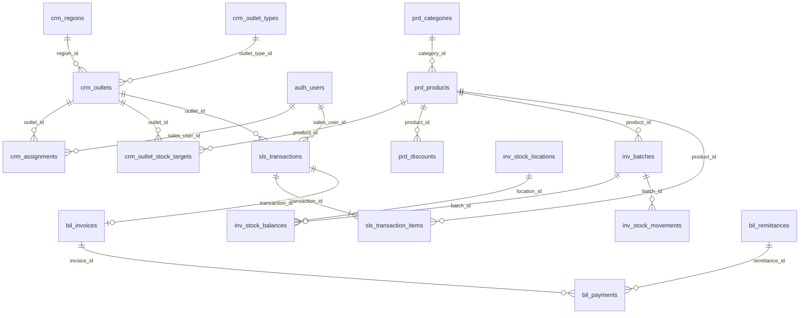

# Arsitektur_Basis_Data — SIGAP CV Arba'in

18 November 2026 · Antech Async · Turunan dari dokumen 04 (System Design) §3–§4 dan 06 (Maklon) §7 · Keputusan: [ADR 0002](../adr/0002-kode-inggris-dan-prefix-tabel.md)

Dokumen ini adalah **sumber kebenaran untuk nama tabel dan kolom**. Dokumen 04 dan 06 menjelaskan konsepnya dalam Bahasa Indonesia (`transaksi`, `saldo_stok`, …). Saat menulis migrasi, pakai nama di dokumen ini.

## 1. Tiga aturan utama

1. **Kode dan basis data memakai Bahasa Inggris. Tampilan memakai Bahasa Indonesia.** Nama tabel, kolom, kelas, fungsi, variabel, rute API, nama izin, nilai enum, dan komentar kode ditulis dalam Bahasa Inggris. Teks yang dibaca pengguna, seperti label, pesan galat, isi notifikasi, dan label izin/peran, tetap berbahasa Indonesia. Padanan istilah ada di §7.
2. **Tabel satu kelompok memakai prefix yang sama.** Prefix menunjukkan modul pemilik tabel. Saat membuka daftar tabel di phpMyAdmin/TablePlus, tabel satu modul otomatis berkumpul.
3. **Hanya modul pemilik yang menulis ke tabelnya.** Modul lain boleh membaca atau memasang foreign key, tetapi perubahan data harus lewat Action atau Event modul pemilik (dokumen 08 §2).

## 2. Prefix per kelompok

| Prefix | Kelompok | Modul backend (`app/Modules/…`) | Scope commit | Folder frontend (`src/features/…`) |
| --- | --- | --- | --- | --- |
| `sys_` | Infrastruktur framework: migrasi, cache, antrean, log audit | — (konfigurasi `config/`) | `infra` | — |
| `auth_` | Pengguna, peran, izin, token perangkat | `Auth` | `auth` | `auth` |
| `core_` | Mekanisme lintas modul: persetujuan, status, impor, tutup buku | `app/Core` | `core` | — |
| `cfg_` | Pengaturan aturan bisnis dan field kustom | `Setting` | `setting` | `setting` |
| `crm_` | Outlet (pelanggan B2B), wilayah, penugasan sales | `Outlet` | `outlet` | `outlet` |
| `prd_` | Produk, kategori, potongan | `Product` | `product` | `product` |
| `inv_` | Gudang dan stok: lokasi, batch, saldo, mutasi, dokumen gudang | `Inventory` | `inventory` | `inventory` |
| `sls_` | Kunjungan titip jual dan penjualan langsung | `Sales` | `sales` | `sales` |
| `bil_` | Tagihan, pembayaran, setoran | `Billing` | `billing` | `billing` |
| `rpt_` | Dicadangkan untuk tabel rekap laporan bila nanti dibutuhkan. Laporan sekarang dihitung langsung dari tabel transaksi, tagihan, dan stok (`Report\Reports\*`) tanpa tabel sendiri | `Report` | `report` | `report` |
| `mfg_` | Maklon (fase 4, dokumen 06) | `Manufacturing` | `manufacturing` | `manufacturing` |

Prefix ditulis huruf kecil, 3–4 huruf, lalu garis bawah. Jangan membuat prefix baru tanpa ADR.

## 3. Aturan penamaan

| Hal | Aturan | Contoh |
| --- | --- | --- |
| Tabel | `<prefix>_<benda_jamak>`, snake_case | `crm_outlets`, `inv_stock_movements` |
| Tabel rincian (header–detail) | `<prefix>_<induk_tunggal>_items` | `sls_transaction_items`, `inv_goods_receipt_items` |
| Kunci utama | `id`. Tabel bisnis (`core_` sampai `mfg_`) memakai **ULID** (`$table->ulid('id')->primary()`), sehingga aman dibuat di banyak perangkat dan mudah digabung. Tabel `sys_` dan `auth_` memakai bawaan paket (bigint) | — |
| Kunci asing | `<benda_tunggal>_id`. Bila ada dua FK ke tabel yang sama atau perannya perlu jelas, tambahkan peran di depan | `outlet_id`, `sales_user_id`, `from_location_id` |
| FK ke pengguna | `<peran>_user_id` atau kolom audit `created_by`, `updated_by`, `approved_by` (semuanya FK ke `auth_users`) | `sales_user_id`, `received_by` |
| Boolean | `is_…` / `has_…` / `needs_…` | `is_active`, `needs_review` |
| Waktu lengkap | `…_at` (timestamp) | `transacted_at`, `voided_at` |
| Tanggal saja | `…_date` | `expiry_date`, `due_date` |
| Jumlah barang | `…_qty`, integer. Tanpa tanda (`unsignedInteger`) kecuali selisih/penyesuaian | `sold_qty`, `difference_qty` |
| Uang | `decimal(15, 2)`. Nama tanpa "rp" | `unit_price`, `total` |
| Persen | `decimal(5, 2)`, akhiran `_percent` | `discount_percent` |
| Enum/status | `string` (varchar 30), nilai snake_case Bahasa Inggris. Label Indonesia diambil dari PHP enum `label()` | `consignment` → "Titip jual" |
| Salinan data saat transaksi | Nama kolom asli + konteks, disimpan agar transaksi lama tidak ikut berubah | `product_name`, `unit_price` di `sls_transaction_items` |
| Penghapusan | Data master: soft delete (`deleted_at`). Dokumen transaksi: **tidak dihapus**; status `void` + alasan | — |
| Penggabungan data dobel | `merged_into_id` (FK ke tabel yang sama) | `crm_outlets.merged_into_id` |
| JSON | Hanya untuk data yang bentuknya bebas: field kustom, salinan data dari HP | `custom_fields`, `client_payload` |
| Indeks & constraint | Nama otomatis Laravel (sudah mengandung prefix). Jangan menulis nama manual kecuali terlalu panjang (> 64 karakter MySQL) | `crm_outlets_region_id_foreign` |
| File migrasi | `YYYY_MM_DD_HHMMSS_create_<tabel>_table.php`; perubahan: `…_add_<kolom>_to_<tabel>_table.php` | `2026_11_20_000100_create_inv_batches_table.php` |
| Model Eloquent | Nama tunggal tanpa prefix, di modul pemilik, **wajib** menulis `$table` | `App\Modules\Outlet\Models\Outlet` → `protected $table = 'crm_outlets';` |

Tabel milik paket pihak ketiga diberi prefix lewat konfigurasinya, bukan dengan mengubah kode paket. Contohnya `config/permission.php`, `config/queue.php`, `config/cache.php`, `config/session.php`, `config/auth.php`, `config/database.php` (`sys_migrations`), dan model token Sanctum di `Modules/Auth/Models/PersonalAccessToken`.

## 4. Peta relasi inti

## 5. Katalog tabel

Kolom **Status**: **ada** = sudah ada migrasinya; **MVP** = dibuat untuk purwarupa hackathon (SDD §11 tahap 1); **nanti** = setelah purwarupa. Kolom `id`, `created_at`, dan `updated_at` tidak ditulis ulang.

### 5.1 `sys_` — infrastruktur framework

| Tabel | Isi | Status |
| --- | --- | --- |
| `sys_migrations` | Catatan migrasi Laravel | ada |
| `sys_cache`, `sys_cache_locks` | Cache dan kunci (driver database) | ada |
| `sys_jobs`, `sys_job_batches`, `sys_failed_jobs` | Antrean (driver database) | ada |
| `sys_activity_log` | Riwayat perubahan: siapa, kapan, nilai lama/baru (spatie/laravel-activitylog, AK-03). Versi 5 tidak punya opsi nama tabel, jadi `config/activitylog.php` menunjuk model `App\Core\Models\Activity` yang memakai tabel ini. `subject_id` berupa string (ULID); `log_name = history` untuk riwayat per data (KR-10, W12) lewat `App\Core\History\History`, dibaca di `GET /history/{type}/{id}` (outlet, produk, nota, barang masuk, permintaan barang) | ada |
| `sys_push_subscriptions` | Langganan Web Push per perangkat (PW-08), skema paket laravel-notification-channels/webpush; `table_name` diatur di `config/webpush.php`. Diisi saat pengguna menekan "Nyalakan di perangkat ini" di panel notifikasi | ada |
| `sys_notifications` | Notifikasi di lonceng (PW-08), kanal database Laravel; model `App\Core\Models\Notification`. Dikirim lewat `App\Core\Notify\Notifier` (ke pemegang izin atau satu pengguna) dengan `App\Core\Notify\Alert`: lonceng langsung, push ke perangkat lewat antrean. Pemicu: persetujuan menunggu (koreksi, barang keluar, potongan, opname, usulan outlet), permintaan barang baru, penugasan outlet, hasil usulan/permintaan/koreksi; ringkasan pagi ED dekat dan tagihan lewat jatuh tempo (`sigap:daily-notifications`, 07.00) | ada |
| `sys_features` | Feature flag Laravel Pennant. Atur `stores.database.table` di `config/pennant.php` | nanti |

### 5.2 `auth_` — pengguna dan akses

| Tabel | Kolom penting | Status |
| --- | --- | --- |
| `auth_users` | `name`, `username` (unik, 3–50 karakter huruf/angka/`.`/`_`, wajib ada huruf agar tidak tertukar dengan nomor HP; `Login::USERNAME_PATTERN`), `phone` (unik, format `08…`), `email`, `is_active`, `last_login_at`, `password` | ada |
| `auth_personal_access_tokens` | Token Sanctum; satu token = satu perangkat (`name` = nama perangkat). Kolom `last_synced_at` ditambah saat modul sinkron dibuat | ada |
| `auth_roles`, `auth_permissions` | Peran dan izin (spatie/laravel-permission). `auth_roles` ditambah `label` (nama peran di layar, mis. "Kepala Gudang") dan `area` (`field` = layar HP sales, `office` = layar kantor & gudang); model `Auth\Models\Role`. Daftar izin dan pengelompokannya di layar W9 ada di `Auth\Permissions`. Perubahan peran dan pengguna masuk riwayat (`sys_activity_log`, `log_name = access`). Paling sedikit satu pengguna aktif harus tetap punya `user.manage` (`Auth\AccessGuard`) | ada |
| `auth_model_has_roles`, `auth_model_has_permissions`, `auth_role_has_permissions` | Tabel penghubung spatie | ada |
| `auth_password_reset_tokens`, `auth_sessions` | Bawaan Laravel | ada |

Nama izin: `<resource>.<action>`, misalnya `outlet.manage` atau `discount.approve`. Daftar lengkap beserta label Indonesianya ada di `App\Modules\Auth\Permissions`. Izin `outlet.view_all` membedakan siapa yang melihat semua outlet (Pimpinan, Admin Kantor) dan siapa yang hanya melihat outlet tugasnya (Sales); jangan membedakannya dengan nama peran. Nama peran: `manager` (Pimpinan), `office_admin` (Admin Kantor), `warehouse_admin` (Admin Gudang), `sales` (Sales), dengan label di `App\Modules\Auth\Roles::LABELS`.

### 5.3 `core_` — mekanisme lintas modul

| Tabel | Konsep di SDD | Kolom penting | Status |
| --- | --- | --- | --- |
| `core_approvals` | `persetujuan` (§4.4) | `type` (`discount`, `stock_request`, `stock_adjustment`, …), `approvable_type` + `approvable_id` (morph ke dokumen), `status` (`pending`, `approved`, `rejected`), `requested_by`, `decided_by`, `decided_at`, `note` | MVP |
| `core_status_transitions` | `aturan_status` (§4.5) | `document_type`, `from_status`, `to_status`, `permission`, `requires_reason` | nanti |
| `core_status_histories` | `riwayat_status` (§4.5) | `statusable_type` + `statusable_id`, `from_status`, `to_status`, `user_id`, `reason`. Diisi saat status dimundurkan dengan alasan (KR-05), sekarang untuk permintaan barang lewat `Inventory\Actions\RevertStockRequestStatus`: Sudah keluar → Disiapkan (barang ditarik kembali dari bawaan sales), Disiapkan → Diajukan, Ditolak → Diajukan. Aturan per jenis dokumen masih di kode (`core_status_transitions` nanti) | ada |
| `core_import_batches` | `sesi_impor` (§4.5) | `type` (`outlets`, `products`, `consignment_stock`), `file_name`, `row_count`, `imported_count`, `merged_count`, `skipped_count`, `merges` (JSON: isian yang dilengkapi tiap baris yang digabung, untuk pembatalan), `status` (`imported`, `reverted`), `created_by`, `reverted_by`, `reverted_at`. Outlet dan produk hasil impor menyimpan `import_batch_id`; stok titipan awal dicatat sebagai mutasi `receipt` dengan `source` = sesi impor. Dibuat lewat `Import\Actions\RunImport` setelah pratinjau; dibatalkan lewat `Import\Actions\RevertImport` (KR-14) hanya bila datanya belum dipakai; baris outlet yang mirip outlet lama bisa di-[Gabung] (W10, OT-06): tidak dibuat baru, hanya melengkapi alamat/WA/siklus yang kosong dan menambah penugasan sales; membatalkan sesi mengembalikan isian itu kecuali sudah diubah orang | ada |
| `core_closed_periods` | `periode_tutup` (§4.5, KR-15) | `period` (teks `2026-10`, sama di MySQL dan SQLite), `closed_by`, `closed_at`. Baris terakhir berarti "ditutup sampai": semua bulan sampai bulan itu tertutup. Selama `period_closing_enabled` menyala, dokumen bertanggal di bulan tertutup tidak bisa dibuat, dikoreksi, atau dibatalkan (`App\Core\Period\ClosedPeriods::assertOpen`: nota, pembayaran, barang masuk, retur, barang keluar, impor, target); kunjungan HP yang terlambat terkirim dicatat dengan tanggal hari ini dan ditandai Perlu dicek. Ditutup/dibuka kembali lewat `App\Core\Period\ClosePeriod` di layar Pengaturan; ditolak bila masih ada koreksi, nota perlu dicek, atau opname yang menunggu di bulan itu | ada |

### 5.4 `cfg_` — pengaturan

| Tabel | Konsep di SDD | Kolom penting | Status |
| --- | --- | --- | --- |
| `cfg_settings` | `pengaturan` (§3.1) | `key` (PK, string), `value` (JSON, sehingga angka tetap angka dan saklar tetap true/false), `updated_by`. Hanya kunci yang pernah diubah admin yang disimpan; tipe, batas, nilai awal, dan label layar ada di kode (`Setting\SettingDefinitions`). Disimpan lewat `Setting\Actions\SaveSettings`; setiap perubahan masuk riwayat (`sys_activity_log`, `log_name = setting`) | ada |
| `cfg_custom_fields` | Field kustom (§12, FP-06) | `entity` (`outlet`, `product`, `mfg_order`), `key`, `label`, `type`, `options` (JSON), `is_required`, `sort_order` | nanti |

### 5.5 `crm_` — outlet

| Tabel | Konsep di SDD | Kolom penting | Status |
| --- | --- | --- | --- |
| `crm_regions` | `wilayah` (kabupaten/kota) | `name` (unik), `is_active`. Isi awal 7 kabupaten/kota dari `OutletReferenceSeeder` | ada |
| `crm_outlet_types` | `jenis_outlet` | `name` (unik), `is_active`. Isi awal 9 jenis dari `OutletReferenceSeeder` | ada |
| `crm_outlets` | `outlet` | `code`, `name`, `outlet_type_id`, `region_id`, `district` (kecamatan), `address`, `whatsapp_number`, `sale_mode` (`consignment`, `cash`, `credit`), `visit_cycle_days` (kosong = ikut pengaturan), `is_active`, `merged_into_id`, `custom_fields`, `created_by`, `updated_by`, `deleted_at`, `deleted_by`. `code` dibuat otomatis `OT-0001`, tidak pernah dipakai ulang; `whatsapp_number` disimpan berawalan `0`. Hapus = pindah ke tempat sampah (bisa dipulihkan); ditolak bila modul lain masih memakai outlet (`Outlet\Contracts\OutletUsage`); outlet dobel digabung lewat `Outlet\Actions\MergeOutlets` (OT-06, KR-08): kunjungan, tagihan, stok rak, potongan, dan penugasan pindah ke outlet yang dipertahankan (tiap modul lewat `Outlet\Contracts\OutletMergeStep`), outlet dobel di-soft delete dengan `merged_into_id`, tidak tampil di Tempat Sampah dan tidak bisa dipulihkan; kiriman HP yang masih memakai outlet dobel dicatat ke outlet yang dipertahankan; usulan dari lapangan (OT-05): `proposal_status` (`pending`, `rejected`; kosong = outlet biasa), `proposed_by`, `proposal_note`, `proposal_decided_by/at`, `proposal_decision_note`. Usulan tersembunyi dari semua query lewat global scope `Outlet::PROPOSALS` sampai disetujui (`Outlet\Actions\DecideOutletProposal`: aktif dan ditugaskan ke sales pengusul) | ada |
| `crm_assignments` | `penugasan` | `outlet_id`, `sales_user_id`, `start_date`, `end_date` (kosong = masih aktif), `reason` (alasan penugasan/pindah; wajib saat outlet pindah dari sales), `created_by`. Baris tidak pernah dihapus | ada |
| `crm_outlet_stock_targets` | `stok_standar` | `outlet_id`, `product_id`, `target_qty`, `updated_by`; unik (`outlet_id`, `product_id`). Opsional (OT-07): diisi dari tab Stok titipan di profil outlet (`Outlet\Actions\SaveStockTargets`, kosong = dihapus). Dikirim di paket kerja (`stock_targets`); bila ada, saran isi ulang di HP = stok standar − (sisa − tarik), dibatasi stok bawaan | ada |

### 5.6 `prd_` — produk

| Tabel | Konsep di SDD | Kolom penting | Status |
| --- | --- | --- | --- |
| `prd_categories` | `kategori_produk` | `name` (unik), `is_active` | ada |
| `prd_products` | `produk` | `code` (diisi admin, unik termasuk produk terhapus, disimpan huruf besar), `name`, `category_id`, `bpom_number` (wajib di form; kolom boleh kosong untuk impor lama), `unit`, `selling_price`, `min_stock_qty` (batas peringatan stok gudang), `is_active`, `merged_into_id`, `custom_fields`, `created_by`, `updated_by`, `deleted_by`, `deleted_at`. Stok tidak disimpan di sini, tetapi di `inv_`. Hapus = tempat sampah; ditolak bila modul lain memakai produk (`Product\Contracts\ProductUsage`); produk dobel digabung lewat `Product\Actions\MergeProducts` (KR-08): batch dan stok, baris nota, permintaan barang, potongan, dan nama lain pindah (`Product\Contracts\ProductMergeStep`), nama produk dobel menjadi nama lain; ditolak bila nomor batch yang sama ada di kedua produk | ada |
| `prd_product_aliases` | Nama lama produk untuk impor (§10) | `product_id`, `alias` (unik) | ada |
| `prd_discounts` | `potongan` | `outlet_type_id`, `product_id`, `outlet_id` (minimal satu terisi; outlet tidak digabung dengan jenis outlet), `discount_percent`, `valid_from`, `status` (`pending`, `active`, `inactive`, `rejected`), `created_by`, `decided_by`, `decided_at`, `decision_note` (wajib saat ditolak). Urutan menang: outlet + produk > outlet > jenis outlet + produk > produk > jenis outlet, lalu `valid_from` terbaru (`Product\Actions\ResolveDiscount`). Tidak diubah setelah berlaku: perubahan = potongan baru | ada |

### 5.7 `inv_` — gudang dan stok

| Tabel | Konsep di SDD | Kolom penting | Status |
| --- | --- | --- | --- |
| `inv_stock_locations` | `lokasi_stok` | `type` (`warehouse`, `salesperson`, `outlet`, `returns`, `disposed`), `user_id` (bila salesperson), `outlet_id` (bila outlet), `owner_id` (kosong = Arba'in; untuk maklon), `name`, `key` (unik: `warehouse`, `returns`, `disposed`, `salesperson:<user_id>`, `outlet:<outlet_id>`; dibuat lewat `Inventory\Actions\StockLocations`) | ada |
| `inv_batches` | `batch` | `product_id`, `batch_number`, `production_date`, `expiry_date`, `owner_id`; unik (`product_id`, `batch_number`); nomor batch disimpan huruf besar | ada |
| `inv_stock_balances` | `saldo_stok` | `location_id`, `batch_id`, `qty` (≥ 0: kolom unsigned dan dicek `RecordStockMovement` sebelum menulis); unik (`location_id`, `batch_id`) | ada |
| `inv_stock_movements` | `mutasi_stok` (buku besar) | `batch_id`, `from_location_id`, `to_location_id`, `qty`, `type` (`receipt`, `issue`, `refill`, `sale`, `withdrawal`, `return`, `disposal`, `adjustment`), `source_type` + `source_id` (dokumen asal), `reverses_id`, `created_by`. `note`. **Tidak pernah diubah atau dihapus**; koreksi = mutasi baru. `from` kosong = masuk dari luar, `to` kosong = keluar dari pembukuan | ada |
| `inv_goods_receipts` + `_items` | Barang masuk | Header: `number`, `received_date`, `note`, `status` (`active`, `void`), `created_by`, `voided_by`, `voided_at`, `void_reason`. Dibatalkan lewat `Inventory\Actions\VoidGoodsReceipt` (KR-04) selama barangnya masih di gudang; batch yang hanya pernah masuk lewat penerimaan yang dibatalkan boleh diterima ulang dengan ED yang benar. Item: `batch_id`, `qty`. Nomor `BM-yymm-0001` `client_uuid` (unik, boleh kosong): dikirim dari perangkat gudang yang mencatat tanpa sinyal (PW-06); kiriman ulang mengembalikan dokumen yang sama | ada |
| `inv_stock_requests` + `_items` | Permintaan barang sales | Header: `number`, `sales_user_id`, `status` (`submitted`, `prepared`, `issued`, `rejected`). `note`, `warehouse_note`, `prepared_by/at`, `issued_by/at`, `rejected_by/at`. Item: `product_id`, `requested_qty`, `issued_qty`, `allocations` (JSON batch yang dipilih saat disiapkan, dipindah saat keluar). Nomor `PB-` | ada |
| `inv_returns` + `_items` | Retur ke gudang | Header: `number`, `sales_user_id`, `status`. `received_date`, `note`, `status` (`active`, `void`), `voided_by`, `voided_at`, `void_reason`. Retur langsung tercatat; yang salah dibatalkan lewat `Inventory\Actions\VoidStockReturn` (KR-04) selama barangnya masih di tempat tujuan retur: barang kembali ke bawaan sales, lalu retur yang benar dicatat ulang. Item: `batch_id`, `qty`, `condition` (`sellable` → gudang, `damaged` → retur/rework, `expired` → musnah). Nomor `RT-` `client_uuid` (unik, boleh kosong): dikirim dari perangkat gudang yang mencatat tanpa sinyal (PW-06); kiriman ulang mengembalikan dokumen yang sama | ada |
| `inv_stock_adjustments` + `_items` | Opname / penyesuaian stok | Header: `number`, `location_id`, `reason`, `status`. `counted_date`, `decided_by/at`, `decision_note`; status `pending`, `applied`, `rejected`, `reopened`; `reopened_by`, `reopened_at`, `reopen_reason`. Opname hari ini bisa dibuka ulang (KR-13, `Inventory\Actions\ReopenStockAdjustment`): selisih yang sudah dibukukan dibalik lewat mutasi `correction`, lalu dihitung ulang sebagai opname baru; opname hari sebelumnya diperbaiki dengan opname baru + alasan. Item hanya batch yang berselisih: `batch_id`, `system_qty`, `physical_qty`, `difference_qty`. Nomor `OP-` `client_uuid` (unik, boleh kosong): dikirim dari perangkat gudang yang mencatat tanpa sinyal (PW-06); kiriman ulang mengembalikan dokumen yang sama | ada |

Mutasi stok hanya dibuat lewat satu Action, `App\Modules\Inventory\Actions\RecordStockMovement`, di dalam satu transaksi DB yang sekaligus memperbarui `inv_stock_balances`.

### 5.8 `sls_` — kunjungan dan penjualan

| Tabel | Konsep di SDD | Kolom penting | Status |
| --- | --- | --- | --- |
| `sls_transactions` | `transaksi` | `client_uuid` (unik, dari HP untuk kirim ulang tanpa dobel), `number` (`NT-yymm-0001`), `type` (`consignment_visit`, `direct_sale`), `outlet_id`, `sales_user_id`, `transacted_at` (jam di HP), `subtotal`, `discount_total`, `total`, `form_photo_path` (disk privat, dilihat lewat API), `status` (`active`, `corrected`, `void`), `corrects_id`, `voided_by`, `voided_at`, `void_reason`, `needs_review`, `review_notes` (alasan "Perlu dicek"), `client_payload` (salinan data HP saat konflik), `reviewed_by`, `reviewed_at` (sudah dicek admin, KR-11), `import_batch_id`. Dicatat lewat `Sales\Actions\RecordTransaction`: server menghitung ulang semua angka; angka HP yang usang tidak ditolak, tetapi dicatat sebisanya dan ditandai `needs_review`. Outlet/produk yang punya transaksi tidak bisa dihapus (`Sales\Usage\*`) | ada |
| `sls_transaction_items` | `transaksi_detail` | `transaction_id`, `product_id`, `product_name`, `opening_qty`, `remaining_qty`, `sold_qty`, `withdrawn_qty`, `refill_qty`, `closing_qty`, `unit_price`, `discount_percent`, `line_total`. Kolom titip (`opening_qty`, `remaining_qty`, `closing_qty`) kosong untuk beli langsung | ada |
| `sls_transaction_corrections` | `koreksi` (§4.5, KR-02) | `transaction_id`, `kind` (`correct`, `void`), `outlet_id` (bila nota dipindah outlet), `items` (JSON angka yang benar), `reason`, `status` (`pending`, `applied`, `rejected`), `requested_by`, `decided_by`, `decided_at`, `decision_note`, `replacement_id`. Siapa boleh apa ada di `Sales\Actions\CorrectionRules`: pembuat nota memperbaiki langsung selama `edit_window_days`; selain itu koreksi dengan alasan, menunggu `correction.approve` bila `approve_correction` aktif; kunjungan titip hanya bisa dikoreksi selama masih kunjungan terakhir di outletnya. Dijalankan oleh `Sales\Actions\ApplyCorrection`: stok nota lama dibalik (`Inventory\Actions\ReverseMovements`, mutasi `correction` dengan `reverses_id`), nota pengganti dibuat (`corrects_id`), nota lama berstatus `corrected`; tagihan tetap bernomor sama dan ikut nota pengganti. Batal: stok dibalik, tagihan `void`. Uang yang sudah diterima tidak pernah hilang diam-diam: bila tidak muat lagi, ditolak sampai pembayarannya dibatalkan (KR-06) | ada |
| `sls_device_syncs` | `perangkat.terakhir_sinkron` (KR-12) | `user_id` (PK), `queued_count`, `failed_count`, `last_error`, `oldest_waiting_at`, `reported_at`. HP sales melaporkan antrean kirimnya setiap kali berubah (paling lambat 10 menit); kantor melihat siapa yang masih menyimpan data di HP | ada |
| `sls_targets` | `target_sales` (PG-10) | `sales_user_id`, `month` (teks `2026-11`, sama di MySQL dan SQLite), `visit_target`, `revenue_target`, `updated_by`; unik (`sales_user_id`, `month`). Diisi lewat `Sales\Actions\SaveSalesTargets` (izin `target.manage`); perubahan masuk riwayat (`log_name = target`). Dipakai Ringkasan pimpinan (LP-01) dan Performa sales (LP-02) | ada |

Padanan kolom rekap Excel mitra (A-M-R-L-S, dokumen 04 §3.2): A = `opening_qty`, M = `refill_qty`, R = `remaining_qty`, L = `sold_qty`, S = `closing_qty`; tarik = `withdrawn_qty`.

### 5.9 `bil_` — tagihan

| Tabel | Konsep di SDD | Kolom penting | Status |
| --- | --- | --- | --- |
| `bil_invoices` | `tagihan` | `number` (`TG-yymm-0001`), `type` (`sales`; nanti `mfg_sample`, `mfg_license_dp`, …), `transaction_id` (unik, boleh kosong), `outlet_id`, `sales_user_id` (BR-08), `invoice_date`, `amount`, `paid_amount`, `due_date` (beli langsung: hari transaksi; titip jual: + siklus kunjungan outlet, karena ditagih di kunjungan berikutnya; tempo: + `credit_term_days`), `status` (`unpaid`, `partial`, `paid`, `void`). Dibuat lewat `Billing\Actions\CreateSalesInvoice` saat ada yang laku | ada |
| `bil_payments` | `pembayaran` | `client_uuid` (unik, boleh kosong: untuk pembayaran terpisah dari HP), `invoice_id`, `transaction_id` (kunjungan tempat uang diterima), `amount`, `method` (`cash`, `transfer`), `paid_at`, `received_by`, `remittance_id`, `status` (`valid`, `void`), `note`, `voided_by`, `voided_at`, `void_reason` (KR-06: dibatalkan dengan alasan lewat `Billing\Actions\VoidPayment`; uang yang sudah disetor tidak bisa dibatalkan). Uang dibagi ke tagihan outlet yang belum lunas, terlama dulu (`Billing\Actions\ApplyOutletPayment`) | ada |
| `bil_remittances` | `setoran` | `number` (`ST-yymm-0001`), `sales_user_id`, `remittance_date`, `expected_amount` (pembayaran tunai yang diterima sales dan belum disetor), `amount`, `difference` (`amount − expected`, negatif = kurang), `note` (wajib bila ada selisih), `received_by`, `received_at`, `status` (`received`, `discrepancy`). Semua pembayaran tunai yang ikut ditautkan lewat `bil_payments.remittance_id` (`Billing\Actions\ReceiveRemittance`) | ada |

### 5.10 `mfg_` — maklon (fase 4)

Nama tabel disiapkan supaya konsisten. Kolom dirinci saat fase 4 dikerjakan (dokumen 06 §7).

| Konsep di dokumen 06 | Tabel |
| --- | --- |
| Klien | `mfg_clients` |
| Order maklon | `mfg_orders` |
| Sampel | `mfg_samples` |
| Perizinan | `mfg_licenses` |
| PO produksi | `mfg_production_orders` |
| Batch produksi | `mfg_production_runs` (hasilnya tetap dicatat sebagai `inv_batches` dengan `owner_id` klien) |
| Hasil QC | `mfg_qc_results` |
| Bahan & kemasan | `mfg_materials` |
| Pemakaian bahan | `mfg_material_usages` |
| Permintaan pembelian | `mfg_purchase_requests` |
| Pengiriman | `mfg_shipments` |
| Klaim | `mfg_claims` |
| Tagihan maklon | Memakai `bil_invoices` (kolom `type` diawali `mfg_`) |

## 6. Kunci pengaturan (`cfg_settings.key`)

Kunci memakai snake_case Bahasa Inggris. Kunci persetujuan mengikuti pola `approve_<type>`, sama dengan `core_approvals.type`.

| Kunci | Konsep di SDD | Bawaan |
| --- | --- | --- |
| `billing_threshold` | `batas_tagih` | 2 |
| `billing_threshold_unit` | `batas_tagih_satuan` | `unit` (atau `product`) |
| `expiry_withdrawal_months` | `batas_tarik_ed_bulan` | 6 |
| `visit_cycle_days` | `siklus_kunjungan_hari` | 30 |
| `credit_term_days` | `tempo_hari` | 30 |
| `form_photo_required` | `foto_form_wajib` | false |
| `approve_stock_request` | `setujui_barang_keluar` | true |
| `approve_discount` | `setujui_potongan` | true |
| `approve_stock_adjustment` | `setujui_opname` | false |
| `edit_window_days` | `batas_ubah_hari` | 0 (hari yang sama) |
| `approve_correction` | `setujui_koreksi` | true |
| `trash_retention_days` | `masa_tempat_sampah_hari` (dihapus permanen tiap malam oleh `sigap:purge-trash`, `App\Core\Trash\PurgeTrash`) | 30 |
| `period_closing_enabled` | `tutup_buku` (KR-15, bagian "Koreksi & tempat sampah") | false |
| `data_saver` | `hemat_data` (foto form hanya lewat Wi-Fi, NF-02) | false |
| `company_name`, `company_address`, `company_whatsapp` | Data perusahaan di nota (PG-09) | `CV Arba'in Jaya Mandiri`, kosong, kosong |
| `mfg_*` | `maklon_*` (dokumen 06 §6), misalnya `mfg_sample_fee`, `mfg_max_sample_revisions` | — |

Di kode, nilai dibaca lewat `App\Modules\Setting\Setting::value('billing_threshold')` (atau `::int()`, `::bool()`, `::string()`). Angka aturan tidak boleh ditulis mati. Nilainya dari `cfg_settings`, atau nilai awal di `SettingDefinitions` bila belum pernah diubah; dibaca sekali per request. Kunci baru: tambahkan di tabel ini dan di `SettingDefinitions::ALL`.

## 7. Glosarium: istilah lapangan → nama di kode

| Istilah (tampilan) | Di kode | | Istilah (tampilan) | Di kode |
| --- | --- | --- | --- | --- |
| Pengguna | `user` | | Batch, ED | `batch`, `expiry_date` |
| Peran / izin | `role` / `permission` | | Lokasi stok, saldo, mutasi | `stock_location`, `stock_balance`, `stock_movement` |
| Pimpinan | `manager` | | Barang masuk | `goods_receipt` |
| Area lapangan / kantor | `field` / `office` | | Permintaan barang | `stock_request` |
| Masuk / keluar | `login` / `logout` | | Opname | `stock_adjustment` |
| Pengaturan | `setting` | | Retur, musnah | `return`, `disposal` |
| Persetujuan | `approval` | | Kunjungan | `visit` |
| Outlet, jenis outlet | `outlet`, `outlet_type` | | Titip jual | `consignment` |
| Wilayah (kab/kota), kecamatan | `region`, `district` | | Beli langsung, tempo | `cash`, `credit` |
| Cara jual | `sale_mode` | | Titipan awal, sisa, laku | `opening_qty`, `remaining_qty`, `sold_qty` |
| Penugasan | `assignment` | | Tarik, isi ulang, stok akhir | `withdrawn_qty`, `refill_qty`, `closing_qty` |
| Stok standar | `stock_target` | | Nota | `transaction` (nomornya `number`); PDF nota: `transaction_pdf` |
| Gabung data dobel | `merge`, `merged_into_id` | | Tagihan | `invoice` |
| Produk, kategori | `product`, `category` | | Pembayaran | `payment` |
| Potongan | `discount` | | Setoran | `remittance` |
| Harga jual | `selling_price` | | Paket kerja | `work_package` |
| Koreksi, batalkan | `correct`, `void` | | Perlu dicek | `needs_review` |
| Sesi impor | `import_batch` | | Tutup buku | `period_closing` |
| Tempat sampah | `trash` | | Maklon | `manufacturing` (`mfg_`) |

Bila istilah baru belum ada di tabel ini, tambahkan dulu di sini lewat PR yang sama. Dengan begitu satu istilah selalu punya satu nama.

## 8. Daftar periksa saat menambah tabel

- [ ] Prefix sesuai modul pemilik (§2) dan nama mengikuti §3
- [ ] Migrasi bernama `create_<tabel>_table`; FK memakai `constrained('<tabel berprefix>')`
- [ ] Model menulis `protected $table` dan berada di `app/Modules/<Modul>/Models`
- [ ] Nilai enum berbahasa Inggris; label Indonesia ada di PHP enum `label()`
- [ ] Tabel dokumen punya `status` dan kolom batal (`voided_*`), bukan hard delete
- [ ] Bila tabel menerima data dari HP: ada `client_uuid` unik
- [ ] Katalog di §5 diperbarui (status **ada**), dan glosarium §7 bila ada istilah baru
