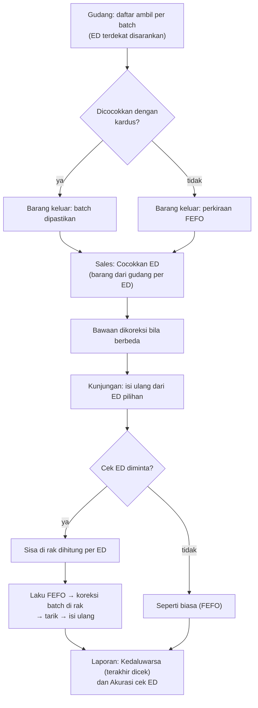

# Pemantauan_ED — SIGAP CV Arba'in

28 November 2026 · Antech Async · Melengkapi dokumen 03 (P2, P3, P6), 04 §4.3, dan 10 §5.7 · Status: **fase 1 dan 2 dikerjakan**, fase 3 menunggu label produk

## 1. Masalah

Sebelum perubahan ini, SIGAP sudah mencatat stok **per batch di setiap lokasi** (gudang, bawaan tiap sales, rak tiap outlet), tetapi batch dipilih dengan **asumsi FEFO** (*First Expired, First Out*) di setiap langkah: gudang mengeluarkan ED terdekat, sales mengisi rak dari ED terdekat, dan yang laku di outlet dianggap batch tertua. Asumsi itu tidak pernah dicek. Bila gudang mengambil kardus lain, sales mengambil botol sembarang dari tas, atau barang baru ditaruh di depan rak, catatan batch menyimpang dari kenyataan tanpa ada yang tahu.

## 2. Prinsip

1. **Sales tidak mencatat batch setiap barang.** Kunjungan tetap cepat (UX-01).
2. **Yang penting adalah batch yang tersisa di rak, bukan yang terjual.** Batch yang terjual dihitung dari selisih.
3. **Cek hanya saat berisiko:** lebih dari satu ED di rak, ED dekat, cek berkala, atau outlet dengan akurasi rendah.
4. **Sales melihat ED sebagai bulan/tahun, bukan nomor batch.** Batch dengan bulan ED yang sama dihitung bersama.
5. **Setiap mutasi punya tingkat kepastian:** `fefo` (perkiraan) atau `confirmed` (dilihat orang).

## 3. Alur

## 4. Kapan cek ED diminta di kunjungan

Dihitung server saat paket kerja diunduh, jadi tetap berlaku tanpa sinyal.

| Pemicu | Cakupan | Pengaturan |
| --- | --- | --- |
| Akurasi 5 cek terakhir di outlet itu di bawah ambang | Semua produk di rak | `expiry_check_min_accuracy` (80%; 0 = mati) |
| Sudah N−1 kunjungan sejak cek terakhir | Semua produk di rak | `expiry_check_every_visits` (4; 0 = mati) |
| Satu produk punya lebih dari satu bulan ED di rak | Produk itu | `expiry_check_multiple` (nyala) |
| ED produk masuk batas tarik | Produk itu | ikut `expiry_check_multiple` |

## 5. Cara kerja di server

- **Kunjungan** (`Sales\Actions\RecordTransaction`): bila baris membawa `remaining_by_expiry` dan jumlahnya sama dengan sisa, urutannya menjadi laku (FEFO) → koreksi ED → tarik → isi ulang. Bila jumlahnya tidak sama atau bulan ED tidak dikenal, kunjungan **tetap tersimpan**, cek untuk produk itu dilewati, dan nota ditandai **Perlu dicek** (KR-11).
- **Koreksi ED** (`Inventory\Actions\RecordExpiryCheck`): membandingkan sistem dan hitungan per bulan ED, lalu memindahkan selisihnya antar-batch **di lokasi yang sama** (dua mutasi `batch_correction`, keluar dan masuk, `basis = confirmed`). Total stok tidak berubah. Batch untuk bulan yang belum ada di lokasi diambil dari batch yang ada di bawaan sales atau gudang.
- **Cek bawaan sales** (`POST /api/v1/inventory/expiry-checks`): sama, untuk lokasi bawaan sales; total per produk harus tetap. Idempoten lewat `client_uuid`.
- **Isi ulang**: `refill_expiry_month` mendahulukan batch dengan bulan ED itu (`AllocateStock`, parameter `preferMonth`).
- **Gudang**: `allocations` yang dikirim dari daftar ambil berarti dicocokkan → `inv_stock_request_items.allocations_confirmed = true` → mutasi barang keluar `confirmed`. Barang masuk dan opname selalu `confirmed`.

## 6. Layar

| Layar | Perubahan |
| --- | --- |
| Gudang → Permintaan sales | Daftar ambil per batch (bisa diubah), centang **Batch sudah dicocokkan dengan kardus yang diambil**, **Cetak bukti keluar**, tanda **dicocokkan** |
| Gudang → Kartu stok | Tanda **Batch dipastikan** pada mutasi `confirmed` |
| HP → Kunjungan titip jual | Banner **Cek ED kunjungan ini**, tanda **Cek ED**, sisa di rak per ED, tombol **ED lain di rak**, saran tarik dari ED yang dihitung, isi ulang menyebut dan bisa memilih ED |
| HP → Hari ini | Stok bawaan per ED, tombol **Cek ED bawaan**, ED barang dari gudang, tombol **Cocokkan ED** |
| Laporan → Kedaluwarsa per produk | Kolom **Terakhir dicek ED** |
| Laporan → **Akurasi cek ED** (baru) | Per pemeriksa dan tempat: jumlah cek, cocok, akurasi, unit dikoreksi |
| Ringkasan → Perlu tindakan | "Akurasi cek ED …% dari … cek" bila di bawah 100% |
| Pengaturan → Kedaluwarsa | Tiga pengaturan di §4 |

## 7. Fase berikutnya

**Fase 3 (menunggu label produk):** pindai QR/barcode batch di kardus dan kemasan (`@zxing/browser` sudah ada di rancangan) serta cetak label QR saat barang masuk. Data dan alur di atas tidak perlu diubah: hasil pindai cukup mengisi daftar ambil dan hitungan per ED secara otomatis.

**Perlu dikonfirmasi ke mitra:** ED dan batch tercetak jelas di kemasan, kebiasaan stiker warna per ED dan rotasi rak, frekuensi cek berkala yang dapat diterima, dan kebutuhan batch untuk klaim retur ke produksi.
